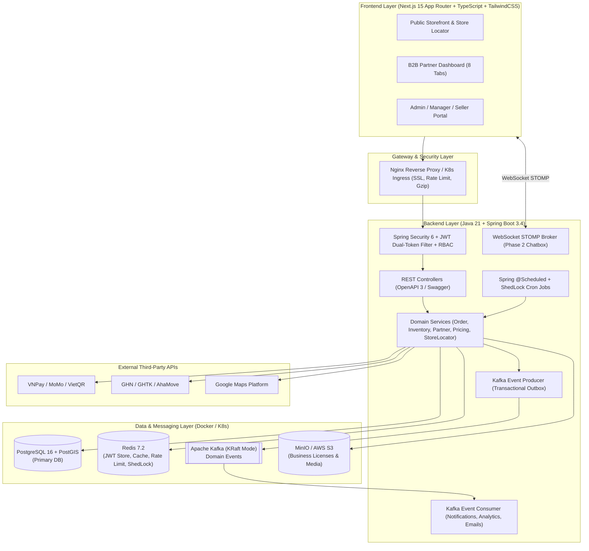

# B2B Store & Warehouse Management Platform

[](https://openjdk.org/projects/jdk/21/)
[](https://spring.io/projects/spring-boot)
[](https://nextjs.org/)
[](https://www.typescriptlang.org/)
[](https://www.postgresql.org/)
[](https://redis.io/)
[](https://kafka.apache.org/)
[](https://www.docker.com/)

An enterprise-grade **B2B Wholesale, Free Sample Request & Multi-Branch Warehouse Management Platform** built with **Java 21 (Spring Boot 3)** and **Next.js (TypeScript + Tailwind CSS)**. Designed for high-concurrency inventory accuracy, SQL performance optimization, strict security, and cloud-native scalability.

---

## 📌 Table of Contents

- [1. Overview & Key Features](#-1-overview--key-features)
- [2. System Architecture](#-2-system-architecture)
- [3. Tech Stack](#-3-tech-stack)
- [4. Project Structure](#-4-project-structure)
- [5. Engineering & Optimization Highlights](#-5-engineering--optimization-highlights)
- [6. Getting Started](#-6-getting-started)
- [7. Documentation Index](#-7-documentation-index)
- [8. Development & Git Workflow](#-8-development--git-workflow)

---

## 🚀 1. Overview & Key Features

The platform serves as both a **Public Corporate & Product Showcase** and a gated **B2B Partner Wholesale Portal** coupled with a **Multi-Branch Admin/Warehouse Backoffice**.

### For End-Users & B2B Partners (Storefront & B2B Portal)
- **Public Brand Showcase & Store Locator**:
  - Product catalog & company introduction.
  - **Radius-Based Store Locator (Google Maps + PostGIS)**: Address autocomplete via **Google Places & Geocoding API**, browser GPS detection, and spatial search (`1km` to `100km`) powered by PostgreSQL/PostGIS `ST_DWithin`.
- **3-Stage B2B Partner Onboarding Workflow**:
  - **Stage 1 (`PENDING_ADMIN` / `REJECTED`)**: Immediate tracking account issued upon registration & business license upload (`PDF/JPG/PNG`). Supports in-place document re-submission (**Re-apply**) if rejected by Admin.
  - **Stage 2 (`ADMIN_APPROVED`)**: Preliminary admin approval with custom onboarding instructions; partner reviews verified legal info and confirms membership.
  - **Stage 3 (`ACTIVE`)**: Full access unlocked to wholesale tier pricing, quick bulk ordering, and free sample requests.
- **Dedicated B2B Partner Dashboard (8 Tabs)**:
  1. **Overview & KPIs**: Cumulative spend, order status breakdown (Donut chart), 6-month purchase trend (Bar chart), and recent orders.
  2. **Quick Order Matrix & One-Page Checkout**: Bulk product matrix with dynamic **Tiered Wholesale Pricing** (e.g., `1–3 Boxes`, `4–6 Boxes`, `7+ Boxes`), real-time shipping fee calculation, and instant checkout.
  3. **Wholesale Catalog & Price List**: Full SKU directory, packaging specs, live multi-warehouse stock availability, and volume price tiers.
  4. **Order Management & Waybill Tracking**: Filterable wholesale and sample orders with real-time carrier tracking links.
  5. **Unified Notifications**: Real-time order/account alerts merged with Admin **Broadcast Announcements** (with automatic recall when an announcement is unpublished or deleted).
  6. **B2B Policy**: Dedicated partner terms, wholesale return policies, and shipping guidelines managed by Admin.
  7. **Free Sample Request Flow**: Exclusive to `ACTIVE` B2B partners—product price is set to `0 VND`, charging only shipping fees (Standard or Express).
  8. **Company Profile & Security**: Read-only locked legal entity fields (Company Name, Tax ID, Business License) with editable delivery contact/address and secure password change.

### For Administrators, Managers & Sellers (Backoffice Portal)
- **Dynamic RBAC (`ADMIN`, `MANAGER`, `SELLER`)**: Granular permission matrix with branch-level data isolation (`user_branch_assignments`).
- **B2B Partner CRM**: 4 real-time KPI cards, multi-stage approval/rejection workflows, and bulk status actions.
- **Multi-Location Branch & Warehouse Inventory Management**:
  - Interactive map coordinate picker, CSV bulk import/export for store locations.
  - Per-branch, per-product stock tracking (`quantity_on_hand`, `quantity_reserved`, `low_stock_threshold`) with full audit trail (`inventory_transactions`).
- **Sales & Analytics Dashboard**:
  - 6 executive KPI cards (Period Revenue + MoM growth %, Total Orders, AOV, New Partners, Delivery Rate %, Cancellation Rate %).
  - Dual-axis Revenue & Order Volume charts (`7 Days`, `1 Month`, `1 Year`), Top 5 Best-Selling Products, Top 5 B2B Customers, and Excel/CSV waybill bulk import/export.
- **Dynamic Third-Party API Configuration**:
  - Admin UI to configure **VNPay**, **MoMo**, **VietQR (PayOS/SePay)**, **GHN / GHTK** (Standard Shipping), **AhaMove** (Same-day Express Shipping), and **Google Maps Platform** (encrypted at rest via `AES-256-GCM`).
- **Phase 2 Roadmap**: Real-time **WebSocket (STOMP)** Chatbox between B2B Partners and Branch Sellers/Admins.

---

## 🏗 2. System Architecture



---

## 🛠 3. Tech Stack

| Layer | Technology | Purpose |
| :--- | :--- | :--- |
| **Backend** | Java 21 LTS, Spring Boot 3.4, Spring Security 6, Spring Data JPA, Flyway | Core REST APIs, RBAC, Transactions, DB Migrations |
| **Frontend** | Next.js 15 (App Router), React 19, TypeScript 5, Tailwind CSS | SSR/CSR Storefront, B2B Portal, Admin Dashboard |
| **Database** | PostgreSQL 16 + PostGIS (`postgis:16-3.4-alpine`) | Relational storage + Spatial radius queries (`GIST` index) |
| **Cache & Lock** | Redis 7.2 (`redis:7.2-alpine`) + Bucket4j + ShedLock | JWT Dual-Token Rotation/Blacklist, KPI Cache, Rate Limiting, Distributed Cron Lock |
| **Message Queue** | Apache Kafka 3.8 (KRaft Mode) | Asynchronous notifications, broadcast fan-out, analytics roll-up |
| **Object Storage** | MinIO (S3-compatible) | Secure storage for B2B business licenses & product media |
| **API Docs & Test** | SpringDoc OpenAPI 3 (Swagger UI), JUnit 5, Mockito, AssertJ, Testcontainers | Automated unit & integration testing, interactive API documentation |
| **DevOps** | Docker, Docker Compose, Kubernetes (K8s), Nginx | Containerization, local orchestration, cloud-native deployment |

---

## 📂 4. Project Structure

```text
B2B-Store-And-Warehouse/
├── PROJECT_CONTEXT.md                  # Master architectural & business context specification
├── README.md                           # Project overview & setup guide (English)
├── .gitignore                          # Git ignore rules for Java, Next.js, Docker, and IDEs
├── docs/                               # Deep-dive technical specifications
│   ├── 01-database-erd-and-indexing.md # PostgreSQL + PostGIS DDL, ERD, Indexing & SQL Optimization
│   ├── 02-api-and-security-spec.md     # JWT Dual-Token, RBAC Matrix, Security & OpenAPI Endpoints
│   ├── 03-third-party-and-async-workflows.md # VNPay/MoMo/VietQR, GHN/AhaMove, Google Maps, Kafka, Cron
│   └── 04-project-structure-and-devops.md    # Package conventions, Docker/K8s, JUnit 5 + Mockito strategy
├── docker-compose.yml                  # Local multi-container stack (Postgres+PostGIS, Redis, Kafka, MinIO, BE, FE)
├── k8s/                                # Kubernetes manifests (Deployments, Services, Ingress, HPA)
├── backend/                            # Spring Boot 3.4 Modular Monolith
│   ├── Dockerfile
│   ├── pom.xml
│   └── src/
│       ├── main/java/com/umego/b2b/
│       │   ├── common/                 # ApiResponse, PageResponse, Exceptions, XSS Sanitizer
│       │   ├── config/                 # Security, Redis, Kafka, OpenAPI/Swagger, WebSocket configs
│       │   ├── security/               # JWT Dual-Token Filter, Token Family Rotation, RBAC Evaluator
│       │   ├── modules/
│       │   │   ├── auth/               # Login, Refresh Token Rotation, Logout
│       │   │   ├── user/               # Users, Roles, Permissions, Branch Assignments
│       │   │   ├── partner/            # 3-Stage B2B Onboarding & CRM
│       │   │   ├── branch/             # Multi-Location Branches & PostGIS Store Locator
│       │   │   ├── catalog/            # Categories, Products & Tiered Wholesale Pricing
│       │   │   ├── inventory/          # Branch Inventories & Atomic Stock Reservation
│       │   │   ├── order/              # Wholesale Orders, Free Sample Orders & Waybill Import/Export
│       │   │   ├── payment/            # VNPay, MoMo & VietQR Strategy Adapters
│       │   │   ├── shipping/           # GHN, GHTK & AhaMove Strategy Adapters
│       │   │   ├── notification/       # Unified User Notifications & Broadcast Announcements
│       │   │   ├── analytics/          # Executive KPIs, Combo Charts & Top Rankings
│       │   │   ├── system/             # Encrypted API Configs & B2B Policy CMS
│       │   │   └── chat/               # Phase 2: Real-time WebSocket STOMP Chatbox
│       │   └── jobs/                   # Scheduled Cron Jobs with ShedLock
│       ├── main/resources/
│       │   ├── db/migration/           # Flyway versioned SQL migrations
│       │   └── application.yml
│       └── test/java/com/umego/b2b/    # JUnit 5 + Mockito Unit & Integration Tests
└── frontend/                           # Next.js 15 App Router (TypeScript + Tailwind CSS)
    ├── Dockerfile
    ├── package.json
    └── src/
        ├── app/
        │   ├── (public)/               # Storefront, Product Showcase, Store Locator, B2B Registration
        │   ├── (b2b-portal)/           # Gated 8-Tab B2B Partner Dashboard & One-Page Checkout
        │   └── (admin)/                # RBAC Admin / Manager / Seller Management Portal
        ├── components/                 # Reusable UI & Domain Components
        ├── hooks/                      # Custom React Hooks
        ├── lib/                        # API Client with Automatic Token Refresh Queue
        └── types/                      # TypeScript Domain Contracts
```

---

## ⚡ 5. Engineering & Optimization Highlights

1. **Zero N+1 Query Guarantee**:
   - `spring.jpa.open-in-view=false` enforced globally.
   - All relationships default to `FetchType.LAZY`; complex reads use DTO Projections, `@EntityGraph`, or batch collection fetching (`default_batch_fetch_size: 50`).
2. **High-Performance Pagination & Indexing**:
   - **Composite Indexes** designed with the **ESR Rule** (*Equality $\rightarrow$ Sort $\rightarrow$ Range*), **Covering Indexes** (`INCLUDE`), **Partial Indexes** on active states (`WHERE status = 'PENDING_PAYMENT'`), and **PostGIS `GIST` Spatial Indexes**.
   - **Keyset (Cursor) Pagination** (`WHERE (created_at, id) < (:cursorDate, :cursorId)`) for high-volume order history, inventory logs, and notifications.
3. **Race Condition & Concurrency Protection**:
   - **Atomic Inventory Reservation**: Single conditional `UPDATE branch_inventories SET quantity_reserved = quantity_reserved + :qty WHERE ... AND (quantity_on_hand - quantity_reserved) >= :qty` combined with JPA `@Version` Optimistic Locking prevents overselling under high concurrency.
   - **Idempotency Keys**: Redis-backed `Idempotency-Key` header prevents duplicate order creation or double payment initiation.
   - **Pessimistic Locking (`SELECT ... FOR UPDATE`)** on payment webhook processing to prevent concurrent IPN race conditions.
4. **Enterprise Security Hardening**:
   - **JWT Dual-Token** with Redis-backed **Refresh Token Rotation & Token Family Reuse Detection**.
   - **XSS Protection** via OWASP Java HTML Sanitizer, strict CSP headers, and **Apache Tika Magic-Bytes** verification for business license uploads.

---

## 💻 6. Getting Started

### Prerequisites
- **JDK 21 LTS** & **Maven 3.9+**
- **Node.js 20 LTS+** & **pnpm / npm**
- **Docker** & **Docker Compose**

### Quick Start with Docker Compose
```bash
# 1. Clone the repository
git clone https://github.com/lyxuantin113/B2B-Store-And-Warehouse.git
cd B2B-Store-And-Warehouse

# 2. Start infrastructure & application services
docker compose up -d
```

- **Frontend (Storefront, B2B Portal, Admin)**: `http://localhost:3000`
- **Backend API & Swagger UI**: `http://localhost:8080/swagger-ui.html`
- **MinIO Console (Object Storage)**: `http://localhost:9001`

---

## 📚 7. Documentation Index

Detailed engineering specifications are maintained under [`docs/`](./docs):
- [**PROJECT_CONTEXT.md**](./PROJECT_CONTEXT.md) — Business domain mapping, system architecture & optimization playbook.
- [**docs/01-database-erd-and-indexing.md**](./docs/01-database-erd-and-indexing.md) — Complete PostgreSQL + PostGIS DDL, ERD, indexing & query optimization.
- [**docs/02-api-and-security-spec.md**](./docs/02-api-and-security-spec.md) — JWT Dual-Token flow, RBAC matrix, security hardening & REST API catalog.
- [**docs/03-third-party-and-async-workflows.md**](./docs/03-third-party-and-async-workflows.md) — VNPay, MoMo, VietQR, GHN, AhaMove, Google Maps, Kafka, Cron Jobs & WebSocket Chat.
- [**docs/04-project-structure-and-devops.md**](./docs/04-project-structure-and-devops.md) — Folder structure, Docker/K8s deployment & JUnit 5 + Mockito testing standards.
- [**docs/05-module-1-implementation-guide.md**](./docs/05-module-1-implementation-guide.md) — Module 1: Infrastructure, Flyway Schema, AES-256-GCM & Core Security.
- [**docs/06-module-2-implementation-guide.md**](./docs/06-module-2-implementation-guide.md) — Module 2: JWT Dual-Token Auth, Redis Rotation, RBAC & 3-Stage B2B Onboarding.
- [**docs/07-module-3-implementation-guide.md**](./docs/07-module-3-implementation-guide.md) — Module 3: Multi-Branch PostGIS, Catalog, Admin Dynamic Price Tiers & Atomic Inventory.
- [**docs/08-module-4-implementation-guide.md**](./docs/08-module-4-implementation-guide.md) — Module 4: B2B Wholesale & Sample Order Engine, Vietnam Payment/Shipping Gateways & Analytics.
- [**docs/09-module-5-implementation-guide.md**](./docs/09-module-5-implementation-guide.md) — Module 5: Store Locator (PostGIS + Google Maps), Unified Notifications, Dynamic Encrypted Configs, Kafka Outbox Relay & ShedLock Cron Jobs.
- [**docs/10-module-6-implementation-guide.md**](./docs/10-module-6-implementation-guide.md) — Module 6: Real-time Support Chatbox (WebSocket STOMP over SockJS), JWT Interceptor & Room Isolation.
- [**docs/11-module-7-implementation-guide.md**](./docs/11-module-7-implementation-guide.md) — Module 7: Frontend Architecture Foundation & Core Infrastructure (Next.js 15, TypeScript, Tailwind CSS, JWT Concurrency Queue).
- [**docs/12-module-8-implementation-guide.md**](./docs/12-module-8-implementation-guide.md) — Module 8: Public Store Locator (PostGIS & Google Maps) & B2B Policy CMS Page.
- [**docs/13-module-9-implementation-guide.md**](./docs/13-module-9-implementation-guide.md) — Module 9: 3-Stage B2B Onboarding Portal & Auth Pages (Login, Register with Stepper, Profile, Change Password).
- [**docs/14-module-10-implementation-guide.md**](./docs/14-module-10-implementation-guide.md) — Module 10: Full B2B Partner Portal (/portal with 8 Tabs: Overview KPIs, Dynamic Matrix Wholesale Order, Catalog, Order History, Notification Center, Policy, Sample Requests, Profile Summary).
- [**docs/15-module-11-implementation-guide.md**](./docs/15-module-11-implementation-guide.md) — Module 11: Admin & Seller Management Portal (/admin Suite: Executive 6 Sales KPIs, Partner CRM 3-Stage Review, Order Fulfillment & Bulk Waybill, Multi-Branch Inventory & Safety Stock, Warehouses PostGIS, Catalog CMS & Dynamic Tiers, Real-time Live Chat Agent Desk, Encrypted System Configs & Staff RBAC).

---

## 🔄 8. Development & Git Workflow

- **Branching Strategy**: Mainline development on `main` (or feature branches merged per module).
- **Module Delivery Rule**: Every completed module (Infrastructure, Auth & RBAC, B2B Onboarding, Multi-Branch Inventory & Catalog, Wholesale/Sample Orders & Payments, Store Locator, Analytics, etc.) must pass unit tests (`mvn test` / `npm run build`) and be **committed & pushed to `origin/main` immediately upon completion**.
