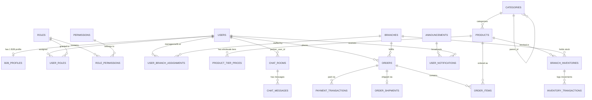

# 01. Thiết Kế Cơ Sở Dữ Liệu (PostgreSQL + PostGIS), Index & Tối Ưu SQL

Tài liệu này định nghĩa toàn bộ cấu trúc bảng (DDL), mối quan hệ thực thể (ERD), chiến lược đánh Index (Đơn / Đôi / Partial / GiST), giải pháp chống lỗi **N+1 Query**, **Phân trang hiệu năng cao** và **Chống Race Condition** cho hệ thống B2B Wholesale & Sample Management.

---

## 1. Sơ Đồ Thực Thể Liên Kết (Entity-Relationship Diagram)



---

## 2. Thiết Kế Schema Chi Tiết (PostgreSQL 16 + PostGIS DDL)

```sql
-- Kích hoạt extension cho UUID và Tìm kiếm không gian (PostGIS)
CREATE EXTENSION IF NOT EXISTS "pgcrypto";
CREATE EXTENSION IF NOT EXISTS "postgis";

-- ============================================================================
-- 1. PHÂN QUYỀN RBAC & TÀI KHOẢN (USERS, ROLES, PERMISSIONS)
-- ============================================================================
CREATE TABLE users (
    id                  BIGSERIAL PRIMARY KEY,
    email               VARCHAR(150) NOT NULL UNIQUE,
    password_hash       VARCHAR(255) NOT NULL,
    full_name           VARCHAR(120) NOT NULL,
    phone               VARCHAR(30),
    user_type           VARCHAR(20) NOT NULL DEFAULT 'B2B_PARTNER', -- ADMIN_STAFF | B2B_PARTNER
    is_active           BOOLEAN NOT NULL DEFAULT TRUE,
    password_changed_at TIMESTAMPTZ,
    last_login_at       TIMESTAMPTZ,
    created_at          TIMESTAMPTZ NOT NULL DEFAULT NOW(),
    updated_at          TIMESTAMPTZ NOT NULL DEFAULT NOW()
);

CREATE TABLE roles (
    id          SMALLSERIAL PRIMARY KEY,
    code        VARCHAR(30) NOT NULL UNIQUE, -- ROLE_ADMIN, ROLE_MANAGER, ROLE_SELLER, ROLE_B2B_PARTNER
    name        VARCHAR(100) NOT NULL,
    description TEXT
);

CREATE TABLE permissions (
    id          SMALLSERIAL PRIMARY KEY,
    code        VARCHAR(80) NOT NULL UNIQUE, -- e.g. PARTNER_APPROVE, PRODUCT_WRITE, INVENTORY_ADJUST, ORDER_PROCESS, CONFIG_MANAGE
    module      VARCHAR(50) NOT NULL,
    description TEXT
);

CREATE TABLE role_permissions (
    role_id       SMALLINT NOT NULL REFERENCES roles(id) ON DELETE CASCADE,
    permission_id SMALLINT NOT NULL REFERENCES permissions(id) ON DELETE CASCADE,
    PRIMARY KEY (role_id, permission_id)
);

CREATE TABLE user_roles (
    user_id BIGINT NOT NULL REFERENCES users(id) ON DELETE CASCADE,
    role_id SMALLINT NOT NULL REFERENCES roles(id) ON DELETE CASCADE,
    PRIMARY KEY (user_id, role_id)
);

-- ============================================================================
-- 2. HỒ SƠ DOANH NGHIỆP B2B (3-STAGE ONBOARDING WORKFLOW)
-- ============================================================================
CREATE TYPE b2b_account_status AS ENUM (
    'PENDING_ADMIN',   -- Stage 1: Mới nộp hồ sơ, chờ Admin duyệt GPKD
    'ADMIN_APPROVED',  -- Stage 2: Admin duyệt sơ bộ (1차 승인), chờ Partner xác nhận thông tin
    'ACTIVE',          -- Stage 3: Đã xác nhận, mở khóa toàn bộ B2B Portal
    'REJECTED',        -- Bị từ chối (cho phép chỉnh sửa & nộp lại / Re-apply)
    'INACTIVE'         -- Tạm khóa bởi Admin
);

CREATE TABLE b2b_profiles (
    id                  BIGSERIAL PRIMARY KEY,
    user_id             BIGINT NOT NULL UNIQUE REFERENCES users(id) ON DELETE CASCADE,
    partner_code        VARCHAR(30) NOT NULL UNIQUE, -- VD: UMG-1001
    company_name        VARCHAR(200) NOT NULL,
    business_type       VARCHAR(100) NOT NULL,       -- Nhà hàng/F&B, Siêu thị/Mart, Đại lý sỉ, Chuỗi Franchise...
    tax_id              VARCHAR(30) NOT NULL,        -- Mã số thuế doanh nghiệp
    contact_name        VARCHAR(120) NOT NULL,
    contact_phone       VARCHAR(30) NOT NULL,
    address_line        VARCHAR(300) NOT NULL,       -- Địa chỉ chuẩn từ Google Maps
    address_detail      VARCHAR(200),                -- Tầng, tòa nhà, số kho
    province_code       VARCHAR(20),
    ward_code           VARCHAR(20),
    latitude            DOUBLE PRECISION,
    longitude           DOUBLE PRECISION,
    license_file_key    VARCHAR(500) NOT NULL,       -- S3/MinIO Object Key của Giấy phép ĐKKD
    license_file_name   VARCHAR(255),
    license_file_size   BIGINT,
    status              b2b_account_status NOT NULL DEFAULT 'PENDING_ADMIN',
    approval_notice     TEXT,                        -- Lời nhắn của Admin ở Bước 2
    rejection_reason    TEXT,                        -- Lý do từ chối ở Bước 1
    reapply_count       INT NOT NULL DEFAULT 0,
    approved_by         BIGINT REFERENCES users(id),
    approved_at         TIMESTAMPTZ,
    confirmed_at        TIMESTAMPTZ,                 -- Thời điểm Partner bấm xác nhận ở Bước 2 -> ACTIVE
    total_spent_amount  NUMERIC(18, 2) NOT NULL DEFAULT 0,
    version             BIGINT NOT NULL DEFAULT 0,   -- Optimistic Locking
    created_at          TIMESTAMPTZ NOT NULL DEFAULT NOW(),
    updated_at          TIMESTAMPTZ NOT NULL DEFAULT NOW()
);

-- ============================================================================
-- 3. CHI NHÁNH / CỬA HÀNG (MULTI-LOCATION & GOOGLE MAPS STORE LOCATOR)
-- ============================================================================
CREATE TABLE branches (
    id              BIGSERIAL PRIMARY KEY,
    code            VARCHAR(30) NOT NULL UNIQUE,     -- VD: BR-HCM-01, BR-HN-01
    name            VARCHAR(200) NOT NULL,
    branch_type     VARCHAR(50) NOT NULL DEFAULT 'OFFICIAL_STORE', -- HEADQUARTERS, WAREHOUSE, OFFICIAL_STORE, AGENCY
    phone           VARCHAR(30) NOT NULL,
    email           VARCHAR(150),
    address_line    VARCHAR(300) NOT NULL,
    address_detail  VARCHAR(200),
    province        VARCHAR(100),
    ward            VARCHAR(100),
    latitude        DOUBLE PRECISION NOT NULL,
    longitude       DOUBLE PRECISION NOT NULL,
    -- Cột Geography của PostGIS tự động tính khoảng cách mặt cầu chính xác theo mét
    location        GEOGRAPHY(Point, 4326) GENERATED ALWAYS AS (
                        ST_SetSRID(ST_MakePoint(longitude, latitude), 4326)::geography
                    ) STORED,
    opening_hours   VARCHAR(100) DEFAULT '08:00 - 22:00',
    map_iframe      TEXT,
    website_url     VARCHAR(300),
    is_pinned       BOOLEAN NOT NULL DEFAULT FALSE,  -- Ghim lên đầu danh sách Store Locator
    is_warehouse    BOOLEAN NOT NULL DEFAULT TRUE,   -- Có cho phép xuất hàng B2B từ chi nhánh này không
    is_active       BOOLEAN NOT NULL DEFAULT TRUE,
    created_at      TIMESTAMPTZ NOT NULL DEFAULT NOW(),
    updated_at      TIMESTAMPTZ NOT NULL DEFAULT NOW()
);

-- Phân công Manager / Seller quản lý chi nhánh cụ thể
CREATE TABLE user_branch_assignments (
    user_id     BIGINT NOT NULL REFERENCES users(id) ON DELETE CASCADE,
    branch_id   BIGINT NOT NULL REFERENCES branches(id) ON DELETE CASCADE,
    is_primary  BOOLEAN NOT NULL DEFAULT FALSE,
    PRIMARY KEY (user_id, branch_id)
);

-- ============================================================================
-- 4. DANH MỤC, SẢN PHẨM, GIÁ SỈ THEO BẬC & TỒN KHO ĐA CHI NHÁNH
-- ============================================================================
CREATE TABLE categories (
    id          BIGSERIAL PRIMARY KEY,
    parent_id   BIGINT REFERENCES categories(id) ON DELETE SET NULL,
    name        VARCHAR(150) NOT NULL,
    slug        VARCHAR(180) NOT NULL UNIQUE,
    sort_order  INT NOT NULL DEFAULT 0,
    is_active   BOOLEAN NOT NULL DEFAULT TRUE,
    created_at  TIMESTAMPTZ NOT NULL DEFAULT NOW()
);

CREATE TABLE products (
    id                  BIGSERIAL PRIMARY KEY,
    category_id         BIGINT REFERENCES categories(id) ON DELETE SET NULL,
    sku                 VARCHAR(60) NOT NULL UNIQUE, -- VD: UMF-S001
    name                VARCHAR(255) NOT NULL,
    slug                VARCHAR(280) NOT NULL UNIQUE,
    short_description   TEXT,
    description         TEXT,
    thumbnail_url       VARCHAR(500),
    gallery_urls        JSONB DEFAULT '[]'::jsonb,
    package_spec        VARCHAR(120) NOT NULL,       -- VD: "400ml/gói, 12 gói/thùng"
    package_unit        VARCHAR(40) NOT NULL DEFAULT 'Thùng', -- Thùng, Hộp, Kiện
    base_retail_price   NUMERIC(15, 2) NOT NULL DEFAULT 0,
    allow_sample        BOOLEAN NOT NULL DEFAULT TRUE,
    max_sample_qty      INT NOT NULL DEFAULT 2,      -- Giới hạn số lượng mẫu thử tối đa mỗi lần xin
    weight_grams        INT NOT NULL DEFAULT 1000,   -- Phục vụ tính phí vận chuyển GHN/GHTK
    is_active           BOOLEAN NOT NULL DEFAULT TRUE,
    created_at          TIMESTAMPTZ NOT NULL DEFAULT NOW(),
    updated_at          TIMESTAMPTZ NOT NULL DEFAULT NOW()
);

-- Bảng giá sỉ theo bậc số lượng (Tiered Wholesale Pricing)
CREATE TABLE product_tier_prices (
    id          BIGSERIAL PRIMARY KEY,
    product_id  BIGINT NOT NULL REFERENCES products(id) ON DELETE CASCADE,
    tier_level  SMALLINT NOT NULL,                   -- 1, 2, 3
    min_qty     INT NOT NULL,                        -- VD: Tier 1: 1, Tier 2: 4, Tier 3: 7
    max_qty     INT,                                 -- VD: Tier 1: 3, Tier 2: 6, Tier 3: NULL (không giới hạn)
    unit_price  NUMERIC(15, 2) NOT NULL,             -- Đơn giá sỉ/thùng ở bậc này
    UNIQUE (product_id, tier_level),
    CONSTRAINT chk_qty_range CHECK (min_qty > 0 AND (max_qty IS NULL OR max_qty >= min_qty))
);

-- Tồn kho riêng biệt theo từng Chi nhánh & từng Sản phẩm
CREATE TABLE branch_inventories (
    id                  BIGSERIAL PRIMARY KEY,
    branch_id           BIGINT NOT NULL REFERENCES branches(id) ON DELETE CASCADE,
    product_id          BIGINT NOT NULL REFERENCES products(id) ON DELETE CASCADE,
    quantity_on_hand    INT NOT NULL DEFAULT 0,      -- Tồn vật lý thực tế trong kho
    quantity_reserved   INT NOT NULL DEFAULT 0,      -- Đang giữ chỗ cho đơn chờ thanh toán / đang đóng gói
    low_stock_threshold INT NOT NULL DEFAULT 10,     -- Ngưỡng cảnh báo sắp hết hàng
    version             BIGINT NOT NULL DEFAULT 0,   -- Optimistic Locking chống Race Condition
    updated_at          TIMESTAMPTZ NOT NULL DEFAULT NOW(),
    UNIQUE (branch_id, product_id),
    CONSTRAINT chk_non_negative_stock CHECK (
        quantity_on_hand >= 0 AND
        quantity_reserved >= 0 AND
        quantity_on_hand >= quantity_reserved
    )
);

-- Lịch sử biến động tồn kho (Audit Trail)
CREATE TABLE inventory_transactions (
    id                  BIGSERIAL PRIMARY KEY,
    branch_inventory_id BIGINT NOT NULL REFERENCES branch_inventories(id),
    order_id            BIGINT,
    tx_type             VARCHAR(30) NOT NULL, -- IMPORT, RESERVE, DEDUCT, RELEASE, ADJUSTMENT
    change_qty          INT NOT NULL,
    balance_after       INT NOT NULL,
    note                VARCHAR(255),
    created_by          BIGINT REFERENCES users(id),
    created_at          TIMESTAMPTZ NOT NULL DEFAULT NOW()
);

-- ============================================================================
-- 5. ĐƠN HÀNG B2B (ĐƠN SỈ & ĐƠN NHẬN MẪU), VẬN CHUYỂN & THANH TOÁN
-- ============================================================================
CREATE TYPE order_type_enum AS ENUM ('WHOLESALE', 'SAMPLE');

CREATE TYPE order_status_enum AS ENUM (
    'PENDING_PAYMENT', -- Chờ thanh toán (VNPay/MoMo/VietQR)
    'PAID',            -- Đã thanh toán
    'PACKING',         -- Đang đóng gói tại chi nhánh
    'READY_TO_SHIP',   -- Chờ gọi tài xế AhaMove hoặc chờ đẩy vận đơn GHN/GHTK
    'FINDING_DRIVER',  -- Đang tìm tài xế giao hỏa tốc
    'DELIVERING',      -- Đang giao hàng
    'COMPLETED',       -- Đã giao thành công
    'CANCELLED',       -- Đã hủy (hoàn trả quantity_reserved)
    'REFUNDED'         -- Đã hoàn tiền
);

CREATE TABLE orders (
    id                      BIGSERIAL PRIMARY KEY,
    order_code              VARCHAR(35) NOT NULL UNIQUE, -- VD: UM-261011-0001
    idempotency_key         VARCHAR(64) UNIQUE,          -- Chống double-submit
    b2b_partner_id          BIGINT NOT NULL REFERENCES users(id),
    branch_id               BIGINT NOT NULL REFERENCES branches(id), -- Chi nhánh xuất kho
    order_type              order_type_enum NOT NULL DEFAULT 'WHOLESALE',
    status                  order_status_enum NOT NULL DEFAULT 'PENDING_PAYMENT',
    company_name_snapshot   VARCHAR(200) NOT NULL,
    tax_id_snapshot         VARCHAR(30),
    recipient_name          VARCHAR(120) NOT NULL,
    recipient_phone         VARCHAR(30) NOT NULL,
    shipping_address        VARCHAR(300) NOT NULL,
    shipping_address_detail VARCHAR(200),
    shipping_lat            DOUBLE PRECISION,
    shipping_lng            DOUBLE PRECISION,
    subtotal_amount         NUMERIC(18, 2) NOT NULL DEFAULT 0, -- Với đơn SAMPLE = 0
    shipping_fee            NUMERIC(15, 2) NOT NULL DEFAULT 0,
    payment_surcharge       NUMERIC(15, 2) NOT NULL DEFAULT 0,
    total_amount            NUMERIC(18, 2) NOT NULL DEFAULT 0,
    payment_method          VARCHAR(30) NOT NULL,              -- VNPAY, MOMO, VIETQR
    shipping_method         VARCHAR(30) NOT NULL,              -- STANDARD_GHN, STANDARD_GHTK, EXPRESS_AHAMOVE
    customer_note           TEXT,
    sample_license_url      VARCHAR(500),                      -- File GPKD đính kèm riêng nếu có
    version                 BIGINT NOT NULL DEFAULT 0,
    paid_at                 TIMESTAMPTZ,
    completed_at            TIMESTAMPTZ,
    cancelled_at            TIMESTAMPTZ,
    created_at              TIMESTAMPTZ NOT NULL DEFAULT NOW(),
    updated_at              TIMESTAMPTZ NOT NULL DEFAULT NOW()
);

CREATE TABLE order_items (
    id                  BIGSERIAL PRIMARY KEY,
    order_id            BIGINT NOT NULL REFERENCES orders(id) ON DELETE CASCADE,
    product_id          BIGINT NOT NULL REFERENCES products(id),
    sku_snapshot        VARCHAR(60) NOT NULL,
    product_name        VARCHAR(255) NOT NULL,
    package_unit        VARCHAR(40) NOT NULL,
    applied_tier_level  SMALLINT,                -- Bậc giá sỉ đã áp dụng (1, 2, 3; NULL nếu là SAMPLE)
    quantity            INT NOT NULL CHECK (quantity > 0),
    unit_price          NUMERIC(15, 2) NOT NULL, -- 0 nếu là đơn SAMPLE
    line_total          NUMERIC(18, 2) NOT NULL
);

CREATE TABLE order_shipments (
    id                  BIGSERIAL PRIMARY KEY,
    order_id            BIGINT NOT NULL UNIQUE REFERENCES orders(id) ON DELETE CASCADE,
    carrier_code        VARCHAR(30) NOT NULL,    -- GHN, GHTK, AHAMOVE
    tracking_number     VARCHAR(100),
    tracking_url        VARCHAR(500),
    driver_name         VARCHAR(100),
    driver_phone        VARCHAR(30),
    shipping_status     VARCHAR(40) NOT NULL DEFAULT 'WAITING_CODE',
    raw_carrier_payload JSONB,
    shipped_at          TIMESTAMPTZ,
    delivered_at        TIMESTAMPTZ,
    updated_at          TIMESTAMPTZ NOT NULL DEFAULT NOW()
);

CREATE TABLE payment_transactions (
    id                  BIGSERIAL PRIMARY KEY,
    order_id            BIGINT NOT NULL REFERENCES orders(id) ON DELETE CASCADE,
    provider            VARCHAR(30) NOT NULL,    -- VNPAY, MOMO, VIETQR
    provider_tx_ref     VARCHAR(100) NOT NULL UNIQUE,
    external_tx_id      VARCHAR(100),
    amount              NUMERIC(18, 2) NOT NULL,
    status              VARCHAR(30) NOT NULL DEFAULT 'INITIATED', -- INITIATED, SUCCESS, FAILED, REFUNDED
    raw_webhook_payload JSONB,
    created_at          TIMESTAMPTZ NOT NULL DEFAULT NOW(),
    updated_at          TIMESTAMPTZ NOT NULL DEFAULT NOW()
);

-- ============================================================================
-- 6. THÔNG BÁO HỢP NHẤT (BROADCAST ANNOUNCEMENTS & USER NOTIFICATIONS)
-- ============================================================================
CREATE TABLE announcements (
    id              BIGSERIAL PRIMARY KEY,
    title           VARCHAR(255) NOT NULL,
    summary         VARCHAR(500),
    content_html    TEXT NOT NULL,               -- Đã qua bộ lọc chống XSS (OWASP HTML Sanitizer)
    status          VARCHAR(20) NOT NULL DEFAULT 'DRAFT', -- DRAFT, PUBLISHED, ARCHIVED
    published_by    BIGINT REFERENCES users(id),
    published_at    TIMESTAMPTZ,
    created_at      TIMESTAMPTZ NOT NULL DEFAULT NOW(),
    updated_at      TIMESTAMPTZ NOT NULL DEFAULT NOW()
);

CREATE TABLE user_notifications (
    id              BIGSERIAL PRIMARY KEY,
    user_id         BIGINT NOT NULL REFERENCES users(id) ON DELETE CASCADE,
    announcement_id BIGINT REFERENCES announcements(id) ON DELETE CASCADE, -- ON DELETE CASCADE giúp tự xóa khi Admin gỡ thông báo chung!
    order_id        BIGINT REFERENCES orders(id) ON DELETE CASCADE,
    notif_type      VARCHAR(30) NOT NULL,        -- ORDER_STATUS, ACCOUNT_STATUS, ANNOUNCEMENT
    title           VARCHAR(255) NOT NULL,
    message         TEXT NOT NULL,
    is_read         BOOLEAN NOT NULL DEFAULT FALSE,
    read_at         TIMESTAMPTZ,
    created_at      TIMESTAMPTZ NOT NULL DEFAULT NOW()
);

-- ============================================================================
-- 7. CẤU HÌNH HỆ THỐNG, CHÍNH SÁCH B2B & TRANSACTIONAL OUTBOX (KAFKA)
-- ============================================================================
CREATE TABLE system_configs (
    config_key      VARCHAR(100) PRIMARY KEY,    -- VD: PAYMENT_VNPAY, SHIPPING_GHN, MAP_GOOGLE, POLICY_B2B_HTML
    config_group    VARCHAR(50) NOT NULL,        -- PAYMENT, SHIPPING, MAP, POLICY
    config_value    JSONB NOT NULL,
    is_encrypted    BOOLEAN NOT NULL DEFAULT FALSE,
    updated_by      BIGINT REFERENCES users(id),
    updated_at      TIMESTAMPTZ NOT NULL DEFAULT NOW()
);

CREATE TABLE outbox_events (
    id              UUID PRIMARY KEY DEFAULT gen_random_uuid(),
    aggregate_type  VARCHAR(50) NOT NULL,        -- ORDER, PARTNER, ANNOUNCEMENT
    aggregate_id    VARCHAR(64) NOT NULL,
    event_type      VARCHAR(80) NOT NULL,
    payload         JSONB NOT NULL,
    status          VARCHAR(20) NOT NULL DEFAULT 'PENDING', -- PENDING, PUBLISHED, FAILED
    retry_count     SMALLINT NOT NULL DEFAULT 0,
    created_at      TIMESTAMPTZ NOT NULL DEFAULT NOW(),
    published_at    TIMESTAMPTZ
);

-- ============================================================================
-- 8. PHASE 2: CHATBOX REALTIME (WEBSOCKET STOMP)
-- ============================================================================
CREATE TABLE chat_rooms (
    id                  BIGSERIAL PRIMARY KEY,
    partner_user_id     BIGINT NOT NULL UNIQUE REFERENCES users(id) ON DELETE CASCADE,
    assigned_staff_id   BIGINT REFERENCES users(id),
    branch_id           BIGINT REFERENCES branches(id),
    last_message_at     TIMESTAMPTZ,
    unread_partner_cnt  INT NOT NULL DEFAULT 0,
    unread_staff_cnt    INT NOT NULL DEFAULT 0,
    created_at          TIMESTAMPTZ NOT NULL DEFAULT NOW()
);

CREATE TABLE chat_messages (
    id          BIGSERIAL PRIMARY KEY,
    room_id     BIGINT NOT NULL REFERENCES chat_rooms(id) ON DELETE CASCADE,
    sender_id   BIGINT NOT NULL REFERENCES users(id),
    content     TEXT NOT NULL,
    attachment  VARCHAR(500),
    is_read     BOOLEAN NOT NULL DEFAULT FALSE,
    created_at  TIMESTAMPTZ NOT NULL DEFAULT NOW()
);
```

---

## 3. Chiến Lược Đánh Index Toàn Diện (Single, Composite, Partial & Spatial)

> [!TIP]
> **Nguyên tắc thiết kế Composite Index (ESR Rule)**: Sắp xếp thứ tự cột theo **E**quality (`=`) $\rightarrow$ **S**ort (`ORDER BY`) $\rightarrow$ **R**ange (`>`, `<`, `BETWEEN`).

```sql
-- 1. SINGLE INDEXES (Tra cứu chính xác theo khóa nghiệp vụ)
CREATE INDEX idx_b2b_profiles_tax_id ON b2b_profiles (tax_id);
CREATE INDEX idx_order_shipments_tracking ON order_shipments (tracking_number) WHERE tracking_number IS NOT NULL;

-- 2. COMPOSITE INDEXES (Tối ưu cho các truy vấn lọc + sắp xếp phổ biến nhất)
-- 2.1. B2B Partner xem danh sách đơn hàng của mình theo trạng thái, mới nhất lên đầu
CREATE INDEX idx_orders_partner_status_created 
    ON orders (b2b_partner_id, status, created_at DESC, id DESC);

-- 2.2. Admin/Seller lọc đơn hàng theo Chi nhánh + Trạng thái + Khoảng thời gian (Dashboard & KPI)
CREATE INDEX idx_orders_branch_status_created 
    ON orders (branch_id, status, created_at DESC)
    INCLUDE (total_amount, order_type); -- Covering Index giúp tính KPI doanh thu Index-Only Scan!

-- 2.3. Admin lọc danh sách đối tác B2B theo trạng thái xét duyệt
CREATE INDEX idx_b2b_profiles_status_created 
    ON b2b_profiles (status, created_at DESC);

-- 2.4. Lấy thông báo của User (chưa đọc / tất cả) sắp xếp mới nhất
CREATE INDEX idx_user_notifs_user_read_created 
    ON user_notifications (user_id, is_read, created_at DESC);

-- 2.5. Tra cứu nhanh giá bậc thang theo sản phẩm và số lượng đặt
CREATE INDEX idx_tier_prices_prod_qty 
    ON product_tier_prices (product_id, min_qty, max_qty);

-- 3. PARTIAL INDEXES (Chỉ đánh index trên tập dữ liệu nóng để giảm 80% dung lượng RAM)
-- 3.1. Cronjob quét các đơn chưa thanh toán quá hạn
CREATE INDEX idx_orders_pending_payment_timeout 
    ON orders (created_at) 
    WHERE status = 'PENDING_PAYMENT';

-- 3.2. Cronjob quét Outbox Events chưa đẩy lên Kafka
CREATE INDEX idx_outbox_pending 
    ON outbox_events (created_at ASC) 
    WHERE status = 'PENDING';

-- 4. SPATIAL INDEX (PostGIS GiST Index cho Store Locator theo bán kính)
CREATE INDEX idx_branches_location_gist 
    ON branches USING GIST (location) 
    WHERE is_active = TRUE;
```

---

## 4. Truy Vấn Tìm Cửa Hàng Gần Nhất Theo Bán Kính (Google Maps + PostGIS)

Thay vì kéo toàn bộ cửa hàng lên PHP/Java rồi lặp tính công thức Haversine như bản WordPress cũ, ta sử dụng **PostGIS `ST_DWithin`** tận dụng `idx_branches_location_gist`:

```sql
-- Tìm các chi nhánh đang hoạt động trong bán kính :radiusMeters (VD: 5000m = 5km)
-- Ưu tiên chi nhánh được ghim (is_pinned = true) sau đó xếp theo khoảng cách gần nhất
SELECT 
    b.id,
    b.code,
    b.name,
    b.branch_type,
    b.address_line,
    b.phone,
    b.opening_hours,
    b.latitude,
    b.longitude,
    b.is_pinned,
    ROUND((ST_Distance(
        b.location,
        ST_SetSRID(ST_MakePoint(:userLng, :userLat), 4326)::geography
    ) / 1000.0)::numeric, 2) AS distance_km
FROM branches b
WHERE b.is_active = TRUE
  AND ST_DWithin(
        b.location,
        ST_SetSRID(ST_MakePoint(:userLng, :userLat), 4326)::geography,
        :radiusMeters
      )
ORDER BY b.is_pinned DESC, distance_km ASC
LIMIT :limit OFFSET :offset;
```

---

## 5. Giải Pháp Triệt Tiêu Lỗi N+1 Query & Tối Ưu Phân Trang Trong Spring Boot

### 5.1. Phòng chống N+1 Query
1. **Cấu hình bắt buộc trong `application.yml`**:
   ```yaml
   spring:
     jpa:
       open-in-view: false # Cấm Lazy Loading ở tầng Controller/Jackson Serialization
       properties:
         hibernate:
           default_batch_fetch_size: 50 # Batch fetching dự phòng cho các collection
   ```
2. **Sử dụng DTO Projection / `@EntityGraph` khi lấy danh sách Sản phẩm kèm Giá sỉ 3 bậc & Tồn kho**:
   - Không bao giờ gọi `productRepository.findAll()` rồi trong vòng lặp gọi `product.getTierPrices()` và `product.getBranchInventories()`.
   - Sử dụng 1 câu truy vấn `JOIN FETCH` hoặc nạp `product_tier_prices` + `branch_inventories` theo `WHERE product_id IN (:productIds)` và gom nhóm bằng `Map<Long, List<TierPriceDto>>` trong bộ nhớ (chỉ tốn đúng **2 câu SQL** thay vì $1 + 2N$ câu SQL).

### 5.2. Keyset (Cursor) Pagination vs Offset Pagination
- **Với B2B Quick Order / Đơn hàng / Thông báo**: Dùng **Keyset Pagination** dựa trên cặp khóa `(created_at, id)`:
  ```sql
  SELECT o.id, o.order_code, o.total_amount, o.status, o.created_at
  FROM orders o
  WHERE o.b2b_partner_id = :partnerId
    AND (:status IS NULL OR o.status = :status)
    AND (o.created_at, o.id) < (:cursorCreatedAt, :cursorId)
  ORDER BY o.created_at DESC, o.id DESC
  LIMIT 20;
  ```
- Nhờ Composite Index `idx_orders_partner_status_created`, PostgreSQL nhảy thẳng tới vị trí con trỏ trong $O(\log N)$ mà không cần đếm bỏ qua (`OFFSET`) hàng chục nghìn dòng trước đó.
