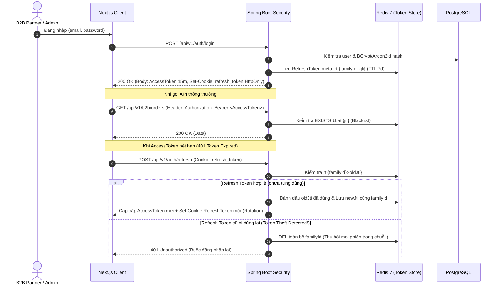

# 02. Đặc Tả RESTful API, Bảo Mật JWT Dual-Token & Phân Quyền RBAC

Tài liệu này định nghĩa kiến trúc bảo mật chuẩn Java Enterprise (Spring Security 6), cơ chế **JWT Dual-Token kết hợp Redis**, ma trận phân quyền **RBAC (`ADMIN`, `MANAGER`, `SELLER`, `B2B_PARTNER`)**, các lớp phòng thủ chống **XSS / Race Condition** và danh sách **RESTful API Endpoints (OpenAPI 3 / Swagger)**.

---

## 1. Kiến Trúc Xác Thực JWT Dual-Token & Quản Lý Phiên Với Redis



### Cấu trúc Claims trong Access Token (TTL: 15 phút)
```json
{
  "jti": "550e8400-e29b-41d4-a716-446655440000",
  "sub": "1024",
  "email": "partner@company.vn",
  "roles": ["ROLE_B2B_PARTNER"],
  "perms": ["ORDER_CREATE", "SAMPLE_REQUEST"],
  "b2b_status": "ACTIVE",
  "branch_ids": [],
  "iat": 1760150000,
  "exp": 1760150900
}
```
> [!IMPORTANT]
> Với tài khoản vừa đăng ký B2B (`b2b_status = PENDING_ADMIN`, `ADMIN_APPROVED` hoặc `REJECTED`), hệ thống vẫn cấp JWT hợp lệ để user truy cập API `/api/v1/b2b/onboarding/**` (theo dõi Stepper 3 giai đoạn, bấm xác nhận Bước 2 hoặc nộp lại hồ sơ), nhưng **Spring Security Custom AuthorizationManager (`@PreAuthorize("@b2bGuard.isActive(authentication)")`)** sẽ chặn truy cập vào các API đặt hàng sỉ và xin mẫu thử cho đến khi `b2b_status == 'ACTIVE'`.

---

## 2. Ma Trận Phân Quyền RBAC (`ADMIN`, `MANAGER`, `SELLER`, `B2B_PARTNER`)

| Module / Chức năng | Permission Code | `ADMIN` | `MANAGER` | `SELLER` | `B2B_PARTNER` |
| :--- | :--- | :---: | :---: | :---: | :---: |
| **Quản lý hệ thống & RBAC** | `SYSTEM_RBAC_MANAGE` | ✅ | ❌ | ❌ | ❌ |
| **Cấu hình API (VNPay, MoMo, Ship, Map)** | `SYSTEM_CONFIG_MANAGE` | ✅ | ❌ | ❌ | ❌ |
| **Cập nhật trang Chính sách B2B** | `POLICY_WRITE` | ✅ | ✅ | ❌ | ❌ |
| **Quản lý Chi nhánh (Multi-location)** | `BRANCH_MANAGE` | ✅ | ✅ *(Chi nhánh được giao)* | ❌ | ❌ |
| **Quản lý Danh mục & Sản phẩm, Giá bậc** | `PRODUCT_MANAGE` | ✅ | ✅ | ❌ *(Chỉ xem)* | ❌ *(Chỉ xem khi Active)* |
| **Quản lý Tồn kho từng chi nhánh** | `INVENTORY_MANAGE` | ✅ | ✅ *(Chi nhánh được giao)* | 🔍 *(Chỉ xem tồn kho)* | ❌ |
| **Thẩm định & Duyệt đối tác B2B** | `PARTNER_APPROVE` | ✅ | ✅ | ❌ | ❌ |
| **Xử lý Đơn hàng sỉ & Đơn mẫu thử** | `ORDER_PROCESS` | ✅ | ✅ | ✅ *(Đơn thuộc chi nhánh)* | ❌ *(Chỉ xem đơn của mình)* |
| **Đăng Thông báo chung (Broadcast)** | `ANNOUNCEMENT_WRITE` | ✅ | ✅ | ❌ | ❌ |
| **Xem Báo cáo Phân tích & KPI Doanh thu** | `ANALYTICS_VIEW` | ✅ *(Toàn hệ thống)* | ✅ *(Theo chi nhánh)* | ❌ | ❌ *(Chỉ xem KPI cá nhân)* |
| **Chatbox hỗ trợ khách hàng (Phase 2)** | `CHAT_SUPPORT` | ✅ | ✅ | ✅ | ✅ *(Chat với Admin/Seller)* |

---

## 3. Các Lớp Bảo Vệ Bảo Mật Chuẩn Java (Security Defense-in-Depth)

1. **Chống tấn công XSS (Cross-Site Scripting)**:
   - **Input Filtering**: Tạo Jackson `StdScalarDeserializer<String>` tự động trim và loại bỏ các thẻ script độc hại cho mọi trường `String` trong `@RequestBody`.
   - **Rich-Text Sanitization**: Với nội dung HTML do Admin nhập (Chính sách B2B, Thông báo chung, Mô tả sản phẩm), bắt buộc đi qua `org.owasp.html.PolicyFactory` (chỉ cho phép các thẻ định dạng văn bản an toàn `p, b, i, u, ul, ol, li, table, tr, td, th, h1..h4, img[src,alt]`, cấm tuyệt đối `script, iframe, object, on*` attributes).
   - **Security Headers**: Cấu hình trong `SecurityFilterChain`:
     - `Content-Security-Policy: default-src 'self'; img-src 'self' data: https:; script-src 'self' https://maps.googleapis.com`
     - `X-Content-Type-Options: nosniff`
     - `X-Frame-Options: DENY`
2. **Chống Brute-Force & DDoS tầng ứng dụng (Rate Limiting)**:
   - Sử dụng **Bucket4j + Redis** tại Filter tầng ngoài:
     - `/api/v1/auth/login`: Tối đa `5 requests / phút / IP`.
     - `/api/v1/b2b/onboarding/register`: Tối đa `3 requests / 10 phút / IP`.
     - `/api/v1/public/stores/nearby`: Tối đa `30 requests / phút / IP` (bảo vệ quota Google Maps Geocoding).
3. **Mã hóa Khóa API Bên thứ 3 (Secret Encryption at Rest)**:
   - Các thông số nhạy cảm do Admin cấu hình trên giao diện (`vnp_HashSecret`, `momo_SecretKey`, `ghn_Token`, `google_MapsServerKey`) trong bảng `system_configs` được mã hóa bằng **AES-256-GCM** thông qua JPA `@Convert(converter = AesGcmEncryptedJsonConverter.class)` trước khi lưu xuống PostgreSQL.

---

## 4. Danh Sách RESTful API Endpoints (Chuẩn Swagger / OpenAPI 3.0)

### 4.1. Public Storefront & Store Locator APIs (`/api/v1/public/**`)
| Method | Endpoint | Mô tả chi tiết |
| :--- | :--- | :--- |
| `GET` | `/api/v1/public/categories` | Lấy cây danh mục sản phẩm hiển thị ngoài trang chủ |
| `GET` | `/api/v1/public/products` | Xem danh sách sản phẩm trưng bày (chưa lộ bảng giá sỉ B2B hoặc chỉ hiện giá bán lẻ tham khảo) |
| `GET` | `/api/v1/public/products/{slug}` | Xem chi tiết sản phẩm & quy cách đóng gói |
| `GET` | `/api/v1/public/stores/nearby` | Tìm cửa hàng/chi nhánh gần nhất theo `lat`, `lng`, `radiusKm`, `province`, `keyword` (PostGIS `ST_DWithin`) |
| `GET` | `/api/v1/public/maps/autocomplete` | Proxy/Autocomplete địa chỉ chuẩn Google Places & Geocoding (có cache Redis theo từ khóa) |
| `GET` | `/api/v1/public/policy` | Xem nội dung trang Chính sách B2B (hoặc yêu cầu đăng nhập tùy cấu hình) |

### 4.2. Authentication & B2B 3-Stage Onboarding APIs (`/api/v1/auth/**`, `/api/v1/b2b/onboarding/**`)
| Method | Endpoint | Mô tả chi tiết |
| :--- | :--- | :--- |
| `POST` | `/api/v1/auth/login` | Đăng nhập (trả về AccessToken + HttpOnly RefreshToken Cookie + trạng thái B2B) |
| `POST` | `/api/v1/auth/refresh` | Làm mới cặp token (Refresh Token Rotation) |
| `POST` | `/api/v1/auth/logout` | Đăng xuất (đưa AccessToken vào Redis Blacklist & xóa RefreshToken) |
| `POST` | `/api/v1/b2b/onboarding/register` | **Stage 1**: Đăng ký tài khoản B2B + Upload GPKD (`multipart/form-data`), tạo ngay account `PENDING_ADMIN` |
| `GET` | `/api/v1/b2b/onboarding/status` | Lấy trạng thái Stepper 3 giai đoạn hiện tại (`PENDING_ADMIN`, `ADMIN_APPROVED`, `REJECTED`, `ACTIVE`), `approval_notice`, `rejection_reason` |
| `PUT` | `/api/v1/b2b/onboarding/reapply` | **Stage 1 (Re-apply)**: Cập nhật thông tin doanh nghiệp & nộp lại GPKD sau khi bị từ chối (`REJECTED` $\rightarrow$ `PENDING_ADMIN`) |
| `POST` | `/api/v1/b2b/onboarding/confirm` | **Stage 2 $\rightarrow$ Stage 3**: Doanh nghiệp xác nhận thông tin sau khi Admin duyệt sơ bộ (`ADMIN_APPROVED` $\rightarrow$ `ACTIVE`) |

### 4.3. B2B Partner Portal APIs (`/api/v1/b2b/**` — Yêu cầu `ROLE_B2B_PARTNER` & `b2b_status == ACTIVE`)
| Method | Endpoint | Mô tả chi tiết |
| :--- | :--- | :--- |
| `GET` | `/api/v1/b2b/dashboard/overview` | **Tab 1**: Lấy 4 thẻ KPI cá nhân, biểu đồ đặt hàng 6 tháng, biểu đồ Donut trạng thái đơn & 4 đơn gần nhất |
| `GET` | `/api/v1/b2b/products/matrix` | **Tab 2 & 3**: Lấy danh sách sản phẩm kèm bảng giá sỉ 3 bậc (`product_tier_prices`) và tồn kho theo chi nhánh |
| `POST` | `/api/v1/b2b/shipping/estimate` | Tính phí vận chuyển realtime (GHN/GHTK hoặc AhaMove theo khoảng cách GPS từ chi nhánh gần nhất) |
| `POST` | `/api/v1/b2b/orders/wholesale` | **Tab 2 Checkout**: Tạo đơn đặt hàng sỉ (tự động tính lại giá bậc ở server, trừ giữ chỗ tồn kho Atomic, trả về URL thanh toán VNPay/MoMo hoặc mã VietQR) |
| `POST` | `/api/v1/b2b/orders/sample` | **Tab 7 Sample Request**: Đăng ký nhận mẫu thử (giá SP = 0đ, chỉ tính phí vận chuyển) |
| `GET` | `/api/v1/b2b/orders` | **Tab 4**: Danh sách đơn hàng (hỗ trợ lọc theo trạng thái, loại đơn `WHOLESALE`/`SAMPLE`, Keyset Pagination) |
| `GET` | `/api/v1/b2b/orders/{orderCode}` | Xem chi tiết đơn hàng, lịch sử vận đơn & thông tin thanh toán |
| `GET` | `/api/v1/b2b/notifications` | **Tab 5**: Lấy danh sách thông báo hợp nhất (đơn hàng + thông báo chung của Admin) + `unreadCount` |
| `PUT` | `/api/v1/b2b/notifications/read-all` | Đánh dấu đã đọc toàn bộ thông báo |
| `GET` | `/api/v1/b2b/profile` | **Tab 8**: Xem hồ sơ doanh nghiệp (các trường pháp nhân Read-only + Pre-signed URL xem GPKD) |
| `PUT` | `/api/v1/b2b/profile` | Cập nhật Người phụ trách, SĐT, Địa chỉ nhận hàng mặc định |
| `PUT` | `/api/v1/b2b/profile/password` | Đổi mật khẩu (kiểm tra mật khẩu cũ, thu hồi các Refresh Token khác) |

### 4.4. Admin / Manager / Seller Management APIs (`/api/v1/admin/**`)
| Method | Endpoint | Quyền yêu cầu | Mô tả chi tiết |
| :--- | :--- | :--- | :--- |
| `GET` | `/api/v1/admin/partners` | `ADMIN`, `MANAGER` | Danh sách đối tác B2B + 4 thẻ KPI (Tổng, Mới 7 ngày, Chờ duyệt, Từ chối) |
| `PUT` | `/api/v1/admin/partners/{id}/status` | `ADMIN`, `MANAGER` | Chuyển trạng thái B2B Partner (`ADMIN_APPROVED`, `ACTIVE`, `REJECTED`, `INACTIVE`) kèm lời nhắn/lý do |
| `POST` | `/api/v1/admin/partners/bulk-status` | `ADMIN`, `MANAGER` | Duyệt / Từ chối / Tạm khóa hàng loạt đối tác B2B |
| `CRUD` | `/api/v1/admin/branches/**` | `ADMIN`, `MANAGER` | Quản lý đa chi nhánh + Import/Export CSV danh sách cửa hàng |
| `CRUD` | `/api/v1/admin/categories/**` | `ADMIN`, `MANAGER` | Quản lý danh mục sản phẩm |
| `CRUD` | `/api/v1/admin/products/**` | `ADMIN`, `MANAGER` | Quản lý sản phẩm, quy cách đóng gói & cấu hình bảng giá sỉ theo bậc (`tier_prices`) |
| `GET/PUT` | `/api/v1/admin/inventories/**` | `ADMIN`, `MANAGER`, `SELLER` | Xem & điều chỉnh tồn kho từng sản phẩm tại từng chi nhánh (`branch_inventories`) |
| `GET` | `/api/v1/admin/orders` | `ADMIN`, `MANAGER`, `SELLER` | Quản lý đơn hàng + 6 thẻ KPI + Xuất/Nhập Excel mã vận đơn hàng loạt |
| `POST` | `/api/v1/admin/orders/{id}/dispatch` | `ADMIN`, `MANAGER`, `SELLER` | Đẩy đơn tự động sang GHN / GHTK / AhaMove để lấy mã vận đơn |
| `GET` | `/api/v1/admin/analytics/dashboard` | `ADMIN`, `MANAGER` | Báo cáo phân tích doanh thu (6 KPI, Biểu đồ kép Doanh thu & Đơn hàng, Top 5 SP, Top 5 Doanh nghiệp, Xuất CSV) |
| `CRUD` | `/api/v1/admin/announcements/**` | `ADMIN`, `MANAGER` | Quản lý Thông báo chung (Publish $\rightarrow$ bắn Kafka broadcast; Trash/Delete $\rightarrow$ thu hồi tức thì) |
| `GET/PUT` | `/api/v1/admin/configs/{group}` | `ADMIN` | Cấu hình API Thanh toán (`PAYMENT`), Vận chuyển (`SHIPPING`), Bản đồ (`MAP`) và Nội dung Chính sách (`POLICY`) |
| `CRUD` | `/api/v1/admin/users/**`, `/roles/**` | `ADMIN` | Quản lý tài khoản nhân sự (`ADMIN`, `MANAGER`, `SELLER`), phân công chi nhánh & cấu hình RBAC |
