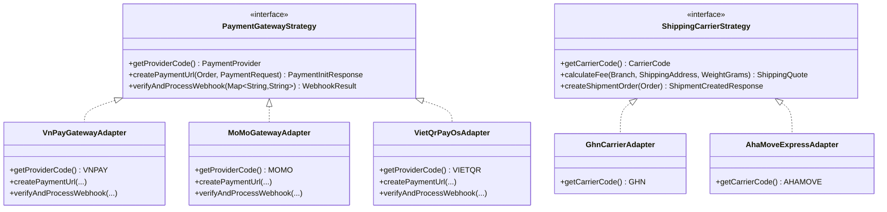

# 03. Tích Hợp Third-Party APIs (Việt Nam), Kafka Event-Driven, Cron Jobs & WebSocket Chat

Tài liệu này mô tả chi tiết phương án thay thế toàn bộ các dịch vụ nội địa Hàn Quốc (Toss Payments, KakaoPay, NaverPay, Logen Express, Kakao T Quick, Daum Postcode / Kakao Map) trong dự án WordPress mẫu `umego` sang hệ sinh thái **VNPay, MoMo, VietQR, GHN/GHTK, AhaMove và Google Maps Platform**, cùng thiết kế **Kafka**, **Cron Jobs (ShedLock)** và **WebSocket STOMP Chatbox**.

---

## 1. Thiết Kế Strategy & Adapter Pattern Cho Cổng Thanh Toán & Vận Chuyển

Để Admin có thể bật/tắt hoặc thay đổi thông số cấu hình API động ngay trên giao diện Quản trị (`/api/v1/admin/configs/PAYMENT` và `SHIPPING`) mà không cần sửa code:

### 1.1. Tích hợp Thanh toán (VNPay, MoMo, VietQR) — Dễ đăng ký Sandbox để phát triển & Demo
1. **VNPay Sandbox** (`https://sandbox.vnpayment.vn/paymentv2/vpcpay.html`):
   - Đăng ký tài khoản Sandbox miễn phí trong 2 phút, cung cấp sẵn `vnp_TmnCode` và `vnp_HashSecret`.
   - Hỗ trợ ký số `HMAC-SHA512`, xác thực Return URL trên Next.js và **IPN Webhook (`/api/v1/webhooks/payment/vnpay`)** trên Spring Boot.
2. **MoMo Developer Sandbox** (`https://test-payment.momo.vn/v2/gateway/api/create`):
   - Cung cấp sẵn bộ `partnerCode`, `accessKey`, `secretKey` test công khai trên GitHub MoMo, hỗ trợ thanh toán QR MoMo và thẻ ATM/Visa.
3. **VietQR Động (PayOS / SePay / VietQR.io)**:
   - Thay thế tính năng tạo mã QR ngân hàng KB Kookmin Bank của bản Hàn: tự động sinh ảnh QR chuẩn Napas247 chứa sẵn số tiền và nội dung chuyển khoản `UM{orderId}`, nhận Webhook tự động chuyển trạng thái đơn từ `PENDING_PAYMENT` sang `PAID`.

### 1.2. Tích hợp Vận chuyển Tiêu chuẩn (GHN / GHTK) & Hỏa tốc (AhaMove)
1. **Giao hàng tiêu chuẩn (Thay thế Logen Express) $\rightarrow$ Giao Hàng Nhanh (GHN Sandbox `dev-online-gateway.ghn.vn`)**:
   - Tính phí tự động theo `from_district_id` (của Chi nhánh xuất hàng) tới `to_district_id`/`to_ward_code` (của B2B Partner) và tổng khối lượng đơn (`weight_grams`).
   - Cho phép cấu hình **Miễn phí vận chuyển (`0 VNĐ`) cho đơn sỉ B2B** hoặc thu phí cố định cho **Đơn nhận mẫu thử (`SAMPLE`)** giống hệt cấu hình trong `b2b-admin.php` của dự án `umego`.
2. **Giao hàng hỏa tốc trong ngày (Thay thế Kakao T Quick) $\rightarrow$ AhaMove API (`apistg.ahamove.com`)**:
   - Khi khách chọn "Giao hỏa tốc trong ngày (3~12h)", Backend lấy tọa độ `(latitude, longitude)` của Chi nhánh gần nhất và tọa độ địa chỉ giao hàng của B2B Partner để gọi API ước tính cước phí theo khoảng cách GPS thực tế (có cấu hình `fallback_express_fee` mặc định ví dụ `50.000 VNĐ` nếu API bên thứ 3 bảo trì).

### 1.3. Tích hợp Google Maps Platform (Thay thế Daum Postcode + Kakao/Naver Map)
1. **Tìm kiếm địa chỉ chuẩn (Address Autocomplete & Geocoding)**:
   - Dùng **Google Places Autocomplete** ở cả 3 nơi: Form Đăng ký B2B, Form Checkout đặt sỉ/nhận mẫu, và Thanh tìm kiếm Cửa hàng (Store Locator).
   - Khi người dùng chọn địa chỉ gợi ý, tự động trích xuất: Địa chỉ đường phố (`address_line`), Phường/Xã (`ward`), Tỉnh/Thành (`province`) và tọa độ `latitude`, `longitude`.
2. **Tìm kiếm Cửa hàng theo bán kính (Store Locator)**:
   - Giao diện 2 cột đồng bộ với plugin `ktech-map`:
     - Cột trái: Bộ lọc bán kính (`1km`, `3km`, `5km`, `10km`, `20km`, `50km`, `100km`, `Toàn quốc`), nút định vị GPS hiện tại, danh sách chi nhánh kèm khoảng cách `km` và badge `Đang mở cửa`.
     - Cột phải: Bản đồ **Google Maps JavaScript API** hiển thị vòng tròn bán kính (`google.maps.Circle`), Marker Clustering và cửa sổ thông tin chi nhánh.

---

## 2. Kiến Trúc Event-Driven Với Apache Kafka & Transactional Outbox

Để tránh việc gửi Email, bắn thông báo cho hàng nghìn B2B Partner hoặc đồng bộ báo cáo làm chậm API đặt hàng/duyệt tài khoản, hệ thống sử dụng **Apache Kafka (KRaft mode — không cần ZooKeeper)**:

| Kafka Topic | Producer Trigger | Consumer Group & Tác vụ xử lý bất đồng bộ |
| :--- | :--- | :--- |
| `b2b.partner.onboarding` | Khi doanh nghiệp nộp đơn đăng ký, nộp lại (Re-apply) hoặc Admin đổi trạng thái (`ADMIN_APPROVED`, `ACTIVE`, `REJECTED`) | 1. Gửi Email thông báo kèm hướng dẫn bước tiếp theo. 2. Ghi `user_notifications` chào mừng khi lên `ACTIVE`. 3. Bắn cảnh báo cho Admin khi có hồ sơ mới chờ duyệt. |
| `b2b.order.lifecycle` | Khi tạo đơn sỉ/đơn mẫu mới, thanh toán thành công (`PAID`) hoặc đổi trạng thái giao vận | 1. Tạo `user_notifications` tự động cho B2B Partner. 2. Xóa/cập nhật Redis Cache KPI Dashboard của Partner và Admin. 3. Gửi thông báo xác nhận đơn mẫu (thay thế Kakao AlimTalk). |
| `b2b.announcement.broadcast` | Khi Admin xuất bản (`PUBLISHED`) một bài Thông báo chung | Fan-out bất đồng bộ theo từng batch (Batch Insert 500 dòng/lần) vào bảng `user_notifications` cho toàn bộ B2B Partner đang `ACTIVE`. |

---

## 3. Hệ Thống Cron Jobs Tự Động (`Spring @Scheduled` + `ShedLock`)

Sử dụng thư viện **`shedlock-spring` + `shedlock-provider-redis-spring`** để đảm bảo khi triển khai nhiều replica trên Kubernetes (K8s), mỗi Cron Job chỉ chạy trên **duy nhất 1 Pod** tại một thời điểm:

1. **`OrderPaymentTimeoutJob` (`@Scheduled(cron = "0 */5 * * * *")` — Mỗi 5 phút)**:
   - Tìm các đơn hàng ở trạng thái `PENDING_PAYMENT` quá `24 giờ`.
   - Chuyển trạng thái đơn sang `CANCELLED`, hoàn trả lại số lượng giữ chỗ (`quantity_reserved = quantity_reserved - orderItem.qty`) trong `branch_inventories` và ghi log `inventory_transactions (type = RELEASE)`.
2. **`ShipmentTrackingSyncJob` (`@Scheduled(cron = "0 */30 * * * *")` — Mỗi 30 phút)**:
   - Đồng bộ trạng thái các vận đơn đang ở `DELIVERING` với API của GHN/GHTK/AhaMove để tự động chuyển sang `COMPLETED` nếu webhook bị lỡ.
3. **`DailySalesAnalyticsRollupJob` (`@Scheduled(cron = "0 15 0 * * *")` — 00:15 mỗi đêm)**:
   - Tổng hợp doanh thu, số lượng đơn sỉ, số lượng đơn mẫu, AOV theo từng chi nhánh của ngày hôm trước và nạp sẵn vào Redis Cache cho trang **Sales Analytics Dashboard**.
4. **`LowStockAlertJob` (`@Scheduled(cron = "0 0 8 * * *")` — 08:00 mỗi sáng)**:
   - Kiểm tra các mặt hàng tại từng chi nhánh có `(quantity_on_hand - quantity_reserved) <= low_stock_threshold` để gửi thông báo nhắc nhập hàng cho `ADMIN` và `MANAGER` phụ trách chi nhánh đó.

---

## 4. Thiết Kế Mở Rộng Phase 2: Chatbox Realtime Giữa B2B Partner & Admin/Seller (WebSocket STOMP)

- **Giao thức**: **Spring WebSocket + STOMP over SockJS** kết hợp **Redis Pub/Sub** (hoặc Kafka) làm Message Broker trung gian để hỗ trợ multi-instance trên K8s.
- **Bảo mật kết nối**: Xác thực JWT `AccessToken` ngay trong `ChannelInterceptor` ở frame `CONNECT` của STOMP.
- **Định tuyến Kênh (Topic/Queue Routing)**:
  - B2B Partner gửi tin nhắn tới `/app/chat.send` $\rightarrow$ Lưu vào bảng `chat_messages` và đẩy tới `/topic/chat.room.{partnerUserId}`.
  - Admin / Seller thuộc chi nhánh phụ trách subscribe vào `/topic/admin.chat.notifications` và `/topic/chat.room.{partnerUserId}` để phản hồi trực tiếp theo thời gian thực, hỗ trợ gửi kèm hình ảnh sản phẩm/hóa đơn hoặc trích dẫn mã đơn hàng (`#UM-...`).
