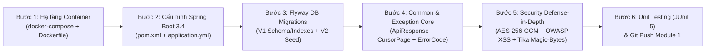

# Module 1 Implementation Guide — Infrastructure & Backend Core (For Inspection & Learning)

Tài liệu này ghi chép chi tiết từng bước triển khai **Module 1 (Infrastructure, Database Migrations, Security & Backend Core)** dưới góc nhìn của một **Senior Fullstack Java Architect**. Mục tiêu là giúp bạn vừa **kiểm tra chất lượng code (Code Review / Verification)** vừa **học sâu bản chất kỹ thuật (Why & How)** đằng sau mỗi quyết định thiết kế cho hệ thống High-Traffic.

---

## Tổng quan Quy trình Triển khai (Step-by-Step Engineering Workflow)



---

## Bước 1: Thiết kế Hạ tầng Container (`docker-compose.yml` & `backend/Dockerfile`)

### 1.1. Các file đã tạo
- [`docker-compose.yml`](file:///Users/xuantin/PersonalProjects/Master_Java/docker-compose.yml)
- [`.env.example`](file:///Users/xuantin/PersonalProjects/Master_Java/.env.example)
- [`backend/Dockerfile`](file:///Users/xuantin/PersonalProjects/Master_Java/backend/Dockerfile)

### 1.2. Giải thích kỹ thuật chuyên sâu (Dành cho việc học)
1. **Tại sao dùng `postgis/postgis:16-3.4-alpine` thay vì `postgres:16-alpine`?**
   - Hệ thống có tính năng **Store Locator (Tìm chi nhánh/kho gần nhất theo tọa độ GPS + bán kính km)** thay thế cho plugin `ktech-map` của WordPress.
   - Nếu tính khoảng cách bằng công thức Haversine thuần bằng SQL (`acos(sin(...) * sin(...))`), PostgreSQL phải **Full Table Scan** toàn bộ bảng `branches`.
   - Với **PostGIS `GEOGRAPHY(Point, 4326)`** kết hợp chỉ mục không gian **`USING GIST (geom)`**, truy vấn `ST_DWithin` và toán tử khoảng cách `<->` (K-Nearest Neighbors) chạy trực tiếp trên R-Tree với độ phức tạp $O(\log N)$.
2. **Tại sao cấu hình Redis với `--appendonly yes` và `--maxmemory-policy volatile-lru`?**
   - Redis đóng 2 vai trò: (1) Lưu **Refresh Token Allowlist** (`rt:{familyId}`) phục vụ cơ chế JWT Dual-Token Rotation, và (2) Cache danh mục sản phẩm / cấu hình.
   - Bật `appendonly yes` (AOF) giúp Redis không làm mất phiên đăng nhập của toàn bộ đối tác B2B khi container khởi động lại.
   - Chính sách `volatile-lru` chỉ giải phóng các key có TTL khi đầy bộ nhớ, bảo vệ an toàn dữ liệu phiên quan trọng.
3. **Tại sao chạy Apache Kafka 3.8 ở chế độ KRaft (`KAFKA_PROCESS_ROLES: broker,controller`)?**
   - Loại bỏ hoàn toàn cụm **ZooKeeper** truyền thống, giảm 50% lượng RAM tiêu thụ trên môi trường Docker local và Kubernetes, khởi động nhanh gấp 3 lần nhưng vẫn giữ nguyên kiến trúc Event-Driven thực tế.
4. **Kỹ thuật tối ưu trong [`backend/Dockerfile`](file:///Users/xuantin/PersonalProjects/Master_Java/backend/Dockerfile):**
   - **Spring Boot Layertools (`-Djarmode=layertools`)**: Tách file `.jar` thành 4 tầng (`dependencies`, `spring-boot-loader`, `snapshot-dependencies`, `application`). Khi bạn sửa code Java, Docker chỉ cần build lại tầng `application` (vài trăm KB) thay vì tải lại hơn 80MB thư viện Maven.
   - **Generational ZGC (`-XX:+UseZGC -XX:+ZGenerational`)**: Garbage Collector thế hệ mới trên Java 21 giữ thời gian dừng (GC Pause Time) dưới **1ms**, cực kỳ quan trọng khi xử lý đồng thời nhiều webhook thanh toán VNPay/MoMo và đặt hàng sỉ.
   - **Non-root User (`USER spring:spring`)**: Chống leo thang đặc quyền (Privilege Escalation) trên Kubernetes.

---

## Bước 2: Khởi tạo Spring Boot 3.4 & Tối ưu Hibernate/HikariCP (`pom.xml` & `application.yml`)

### 2.1. Các file đã tạo
- [`backend/pom.xml`](file:///Users/xuantin/PersonalProjects/Master_Java/backend/pom.xml)
- [`backend/src/main/resources/application.yml`](file:///Users/xuantin/PersonalProjects/Master_Java/backend/src/main/resources/application.yml)
- [`backend/src/test/resources/application-test.yml`](file:///Users/xuantin/PersonalProjects/Master_Java/backend/src/test/resources/application-test.yml)

### 2.2. Các điểm tối ưu High-Traffic quan trọng trong [`application.yml`](file:///Users/xuantin/PersonalProjects/Master_Java/backend/src/main/resources/application.yml)
| Cấu hình | Giá trị | Lý do Kỹ thuật (Senior Best Practice) |
| :--- | :--- | :--- |
| `spring.threads.virtual.enabled` | `true` | Kích hoạt **Java 21 Virtual Threads (Project Loom)**. Khi gọi API bên thứ 3 (VNPay, MoMo, GHN, Google Maps), OS thread không bị block, giúp 1 pod chịu tải hàng nghìn request đồng thời. |
| `spring.jpa.open-in-view` | `false` | **Tắt Open-Session-In-View (OSIV)**. Mặc định Spring Boot bật `true`, khiến DB Connection bị giữ suốt quá trình serialize JSON ở tầng Controller -> gây cạn kiệt HikariCP pool khi traffic cao. |
| `hibernate.default_batch_fetch_size` | `50` | Phòng tuyến chống lỗi **N+1 Query**: Tự động gom các câu lệnh lazy-loading đơn lẻ thành `WHERE id IN (?, ?, ...)` tối đa 50 bản ghi/lần. |
| `hibernate.jdbc.batch_size` + `order_inserts` | `50` + `true` | Khi đối tác B2B đặt đơn sỉ gồm 30 mã sản phẩm (`order_items`), Hibernate gộp toàn bộ lệnh `INSERT` vào 1 network round-trip duy nhất tới PostgreSQL. |
| `provider_disables_autocommit` | `true` + `auto-commit: false` | Không gọi lệnh `SET autocommit=0` thừa ở đầu mỗi connection; chỉ mở transaction đúng lúc bước vào hàm `@Transactional`. |

---

## Bước 3: Thiết kế Database Schema & Chiến lược Indexing bằng Flyway (`db/migration/`)

### 3.1. Các file đã tạo
- [`V1__init_schema_and_indexes.sql`](file:///Users/xuantin/PersonalProjects/Master_Java/backend/src/main/resources/db/migration/V1__init_schema_and_indexes.sql)
- [`V2__seed_rbac_and_default_configs.sql`](file:///Users/xuantin/PersonalProjects/Master_Java/backend/src/main/resources/db/migration/V2__seed_rbac_and_default_configs.sql)

### 3.2. Điểm nhấn Thiết kế Schema & Index (Dành cho việc học)
1. **Tại sao không dùng `spring.jpa.hibernate.ddl-auto: update` mà dùng `validate` + Flyway?**
   - Trong hệ thống Production, `ddl-auto: update` không thể kiểm soát việc tạo **Partial Index**, **GiST Spatial Index**, hay ràng buộc `CHECK (...)`. Dùng **Flyway (`V1`, `V2`)** giúp quản lý phiên bản schema giống như quản lý Git.
2. **Quy tắc ESR (Equality $\rightarrow$ Sort $\rightarrow$ Range) khi đánh Composite Index:**
   - Ví dụ index [`idx_orders_user_type_created`](file:///Users/xuantin/PersonalProjects/Master_Java/backend/src/main/resources/db/migration/V1__init_schema_and_indexes.sql#L261-L262):
     ```sql
     CREATE INDEX idx_orders_user_type_created
         ON orders (user_id, order_type, created_at DESC, id DESC);
     ```
   - `user_id` và `order_type` là điều kiện bằng (**Equality** `=`), `created_at DESC, id DESC` là thứ tự sắp xếp và con trỏ phân trang (**Sort / Keyset Range**). Nhờ đó PostgreSQL trả kết quả phân trang ngay từ B-Tree mà **không cần bước `Sort` trên RAM/Disk**.
3. **Partial Index (Chỉ mục một phần) giúp giảm 80-95% dung lượng RAM cho Index:**
   - Bảng `outbox_events` có thể chứa hàng triệu sự kiện `PUBLISHED`, nhưng Cron Job chỉ quét các sự kiện `PENDING`.
   - Do đó [`idx_outbox_pending_created`](file:///Users/xuantin/PersonalProjects/Master_Java/backend/src/main/resources/db/migration/V1__init_schema_and_indexes.sql#L285-L287) thêm mệnh đề `WHERE status = 'PENDING'`, giữ cho kích thước index luôn gần bằng 0!
   - Tương tự, [`idx_announcements_active_pinned_pub`](file:///Users/xuantin/PersonalProjects/Master_Java/backend/src/main/resources/db/migration/V1__init_schema_and_indexes.sql#L280-L282) chỉ đánh index các thông báo `WHERE is_published = TRUE AND deleted_at IS NULL`, giải quyết triệt để bài toán từ dự án WordPress mẫu (khi Admin xóa/gỡ thông báo thì biến mất tức thì khỏi B2B Portal).

---

## Bước 4: Chuẩn hóa API Envelope, Keyset Pagination & Global Exception Handling

### 4.1. Các file đã tạo
- [`BaseAuditEntity.java`](file:///Users/xuantin/PersonalProjects/Master_Java/backend/src/main/java/com/b2b/warehouse/common/entity/BaseAuditEntity.java)
- [`ApiResponse.java`](file:///Users/xuantin/PersonalProjects/Master_Java/backend/src/main/java/com/b2b/warehouse/common/dto/ApiResponse.java)
- [`CursorPageDto.java`](file:///Users/xuantin/PersonalProjects/Master_Java/backend/src/main/java/com/b2b/warehouse/common/dto/CursorPageDto.java)
- [`ErrorCode.java`](file:///Users/xuantin/PersonalProjects/Master_Java/backend/src/main/java/com/b2b/warehouse/common/exception/ErrorCode.java)
- [`BusinessException.java`](file:///Users/xuantin/PersonalProjects/Master_Java/backend/src/main/java/com/b2b/warehouse/common/exception/BusinessException.java)
- [`GlobalExceptionHandler.java`](file:///Users/xuantin/PersonalProjects/Master_Java/backend/src/main/java/com/b2b/warehouse/common/exception/GlobalExceptionHandler.java)

### 4.2. Giải thích kỹ thuật
- **Chuẩn hóa phản hồi JSON (`ApiResponse<T>`)**: Mọi API thành công hay thất bại đều trả về cấu trúc đồng nhất `{ success, code, message, data, meta, timestamp }`, giúp Frontend Next.js (Axios/Fetch interceptor) xử lý lỗi tập trung.
- **Bắt lỗi Race Condition (`OptimisticLockingFailureException`)**: Trong [`GlobalExceptionHandler`](file:///Users/xuantin/PersonalProjects/Master_Java/backend/src/main/java/com/b2b/warehouse/common/exception/GlobalExceptionHandler.java#L44-L51), khi 2 giao dịch cùng cập nhật tồn kho hoặc duyệt hồ sơ B2B làm lệch cột `@Version`, hệ thống tự động trả về HTTP `409 Conflict` (`ERR_CONCURRENT_MODIFICATION`) thay vì lỗi `500 Internal Server Error`.

---

## Bước 5: Xây dựng Lớp Bảo mật Chiều sâu (Defense-in-Depth Security Core)

### 5.1. Các file đã tạo
- [`AesGcmCryptoUtil.java`](file:///Users/xuantin/PersonalProjects/Master_Java/backend/src/main/java/com/b2b/warehouse/common/util/AesGcmCryptoUtil.java) & [`EncryptedStringConverter.java`](file:///Users/xuantin/PersonalProjects/Master_Java/backend/src/main/java/com/b2b/warehouse/common/util/EncryptedStringConverter.java)
- [`HtmlSanitizerUtil.java`](file:///Users/xuantin/PersonalProjects/Master_Java/backend/src/main/java/com/b2b/warehouse/common/util/HtmlSanitizerUtil.java)
- [`FileMagicBytesValidator.java`](file:///Users/xuantin/PersonalProjects/Master_Java/backend/src/main/java/com/b2b/warehouse/common/util/FileMagicBytesValidator.java)
- [`SecurityConfig.java`](file:///Users/xuantin/PersonalProjects/Master_Java/backend/src/main/java/com/b2b/warehouse/config/SecurityConfig.java), [`ShedLockConfig.java`](file:///Users/xuantin/PersonalProjects/Master_Java/backend/src/main/java/com/b2b/warehouse/config/ShedLockConfig.java), [`RedisConfig.java`](file:///Users/xuantin/PersonalProjects/Master_Java/backend/src/main/java/com/b2b/warehouse/config/RedisConfig.java), [`OpenApiConfig.java`](file:///Users/xuantin/PersonalProjects/Master_Java/backend/src/main/java/com/b2b/warehouse/config/OpenApiConfig.java)

### 5.2. Giải thích 3 cơ chế bảo mật cốt lõi (Dành cho việc học)
1. **Mã hóa Khóa API Thanh toán/Vận chuyển bằng `AES-256-GCM` ([`AesGcmCryptoUtil.java`](file:///Users/xuantin/PersonalProjects/Master_Java/backend/src/main/java/com/b2b/warehouse/common/util/AesGcmCryptoUtil.java)):**
   - Admin có thể cấu hình `VNPay HashSecret`, `MoMo SecretKey`, `GHN Token` từ giao diện quản trị (lưu vào bảng `system_configs`).
   - Không bao giờ lưu plaintext hay dùng `AES/ECB` (dễ lộ mẫu dữ liệu). Chúng ta dùng **`AES/GCM/NoPadding`** với **12-byte Random IV** mới cho mỗi lần mã hóa và **128-bit Authentication Tag**. Nếu kẻ tấn công sửa 1 bit trong DB, quá trình giải mã sẽ lập tức phát hiện giả mạo (`AEADBadTagException`) và chặn lại.
2. **Chống Stored XSS bằng `OWASP Java HTML Sanitizer` ([`HtmlSanitizerUtil.java`](file:///Users/xuantin/PersonalProjects/Master_Java/backend/src/main/java/com/b2b/warehouse/common/util/HtmlSanitizerUtil.java)):**
   - Khi Admin soạn thông báo chung (`announcements`) hoặc trang Chính sách B2B (`B2B_POLICY_HTML`), dữ liệu có chứa HTML (`<h3>`, `<table>`, `<ul>`).
   - `HtmlSanitizerUtil` áp dụng chính sách Whitelist nghiêm ngặt: tự động cắt bỏ mọi thẻ `<script>`, `<iframe>`, thuộc tính sự kiện `onerror`, `onload`, `onclick`, và giao thức `javascript:` trước khi lưu xuống DB.
3. **Chống Upload Shell giả mạo bằng `Apache Tika Magic-Bytes` ([`FileMagicBytesValidator.java`](file:///Users/xuantin/PersonalProjects/Master_Java/backend/src/main/java/com/b2b/warehouse/common/util/FileMagicBytesValidator.java)):**
   - Khi doanh nghiệp đăng ký B2B và đính kèm Giấy phép kinh doanh (`business_license.pdf`), hacker có thể đổi tên file `shell.jsp` hoặc `exploit.sh` thành `license.pdf` và giả mạo header `Content-Type: application/pdf`.
   - `FileMagicBytesValidator` đọc trực tiếp các byte đầu tiên (Magic Bytes) của luồng file (`%PDF-` cho PDF, `89 50 4E 47` cho PNG, `FF D8 FF` cho JPEG) để xác thực định dạng thực sự.

---

## Bước 6: Kiểm thử Tự động (JUnit 5 + AssertJ) & Cách Tự Kiểm tra

### 6.1. Bộ Unit Test đã viết trong Module 1
1. [`AesGcmCryptoUtilTest.java`](file:///Users/xuantin/PersonalProjects/Master_Java/backend/src/test/java/com/b2b/warehouse/common/util/AesGcmCryptoUtilTest.java): Kiểm tra mã hóa/giải mã, tính ngẫu nhiên của IV (2 lần mã hóa cùng 1 chuỗi phải ra 2 bản mã khác nhau), và khả năng phát hiện giả mạo bit dữ liệu (Tamper Detection).
2. [`HtmlSanitizerUtilTest.java`](file:///Users/xuantin/PersonalProjects/Master_Java/backend/src/test/java/com/b2b/warehouse/common/util/HtmlSanitizerUtilTest.java): Kiểm tra lọc sạch mã độc `<script>`, `onerror`, `javascript:` nhưng giữ nguyên định dạng bảng biểu chính sách B2B.
3. [`FileMagicBytesValidatorTest.java`](file:///Users/xuantin/PersonalProjects/Master_Java/backend/src/test/java/com/b2b/warehouse/common/util/FileMagicBytesValidatorTest.java): Kiểm tra nhận diện đúng Magic Bytes của PDF/PNG và chặn đứng script `#!/bin/sh` đội lốt `.pdf`.
4. [`GlobalExceptionHandlerTest.java`](file:///Users/xuantin/PersonalProjects/Master_Java/backend/src/test/java/com/b2b/warehouse/common/exception/GlobalExceptionHandlerTest.java): Kiểm tra ánh xạ chính xác `BusinessException`, `OptimisticLockingFailureException` (409 Conflict) và `AccessDeniedException` (403 Forbidden).

### 6.2. Các lệnh để bạn tự kiểm tra trên máy
```bash
# 1. Chạy toàn bộ Unit Test của Module 1
cd backend
./mvnw test

# 2. Khởi chạy hạ tầng Docker (PostgreSQL 16 + PostGIS, Redis 7, Kafka KRaft, MinIO)
cd ..
docker compose up -d

# 3. Chạy ứng dụng Spring Boot (Flyway sẽ tự động tạo 18 bảng + nạp dữ liệu RBAC)
cd backend
./mvnw spring-boot:run

# 4. Kiểm tra Health Endpoint & Swagger UI
curl http://localhost:8080/api/v1/public/health
# Mở trình duyệt: http://localhost:8080/swagger-ui.html
```
