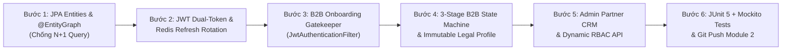
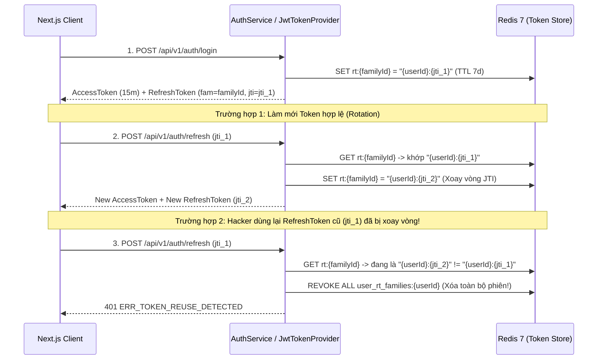
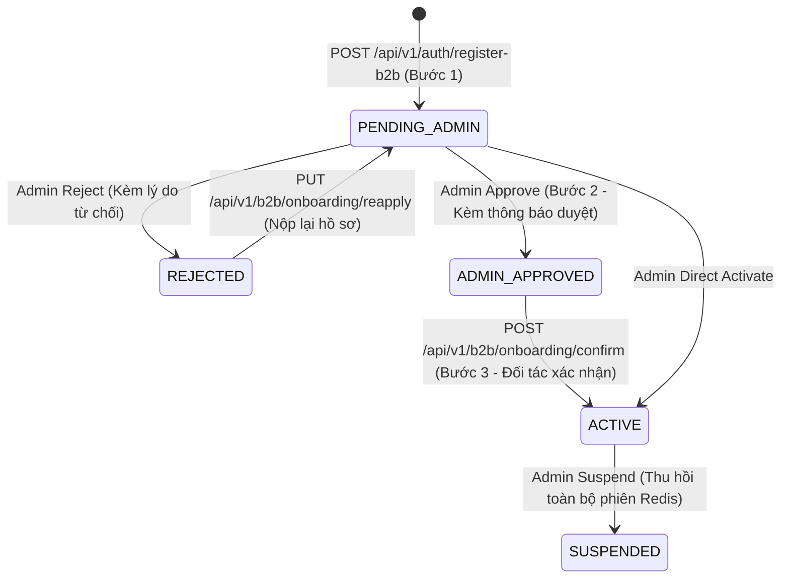

# Module 2 Implementation Guide — JWT Dual-Token Auth, RBAC & 3-Stage B2B Partner Onboarding (For Inspection & Learning)

Tài liệu này ghi chép chi tiết từng bước triển khai **Module 2 (Authentication, Redis Refresh Token Rotation, Granular RBAC & 3-Stage B2B Partner Onboarding)** để bạn kiểm tra (Code Review) và nắm vững các giải pháp kiến trúc cho hệ thống High-Traffic.

---

## Tổng quan Quy trình Triển khai Module 2



---

## Bước 1: Thiết kế JPA Entities & Triệt tiêu lỗi N+1 Query bằng `@EntityGraph`

### 1.1. Các file đã tạo
- Entities: [`AccountStatus.java`](file:///Users/xuantin/PersonalProjects/Master_Java/backend/src/main/java/com/b2b/warehouse/auth/entity/AccountStatus.java), [`RoleCode.java`](file:///Users/xuantin/PersonalProjects/Master_Java/backend/src/main/java/com/b2b/warehouse/rbac/entity/RoleCode.java), [`PermissionEntity.java`](file:///Users/xuantin/PersonalProjects/Master_Java/backend/src/main/java/com/b2b/warehouse/rbac/entity/PermissionEntity.java), [`RoleEntity.java`](file:///Users/xuantin/PersonalProjects/Master_Java/backend/src/main/java/com/b2b/warehouse/rbac/entity/RoleEntity.java), [`UserEntity.java`](file:///Users/xuantin/PersonalProjects/Master_Java/backend/src/main/java/com/b2b/warehouse/auth/entity/UserEntity.java), [`B2bPartnerProfileEntity.java`](file:///Users/xuantin/PersonalProjects/Master_Java/backend/src/main/java/com/b2b/warehouse/partner/entity/B2bPartnerProfileEntity.java)
- Repositories: [`UserRepository.java`](file:///Users/xuantin/PersonalProjects/Master_Java/backend/src/main/java/com/b2b/warehouse/auth/repository/UserRepository.java), [`RoleRepository.java`](file:///Users/xuantin/PersonalProjects/Master_Java/backend/src/main/java/com/b2b/warehouse/rbac/repository/RoleRepository.java), [`PermissionRepository.java`](file:///Users/xuantin/PersonalProjects/Master_Java/backend/src/main/java/com/b2b/warehouse/rbac/repository/PermissionRepository.java), [`B2bPartnerProfileRepository.java`](file:///Users/xuantin/PersonalProjects/Master_Java/backend/src/main/java/com/b2b/warehouse/partner/repository/B2bPartnerProfileRepository.java)

### 1.2. Bài học Tối ưu SQL / Hibernate (Senior Best Practice)
1. **Không bao giờ dùng `FetchType.EAGER` trên `@ManyToOne` hoặc `@ManyToMany`:**
   - Trong [`UserEntity`](file:///Users/xuantin/PersonalProjects/Master_Java/backend/src/main/java/com/b2b/warehouse/auth/entity/UserEntity.java#L47-L49) và [`RoleEntity`](file:///Users/xuantin/PersonalProjects/Master_Java/backend/src/main/java/com/b2b/warehouse/rbac/entity/RoleEntity.java#L38-L45), các quan hệ `role` và `permissions` đều đặt `FetchType.LAZY`.
   - Tại sao? Nếu đặt `EAGER`, mọi câu truy vấn danh sách `users` sẽ bị Hibernate tự động sinh thêm hàng chục câu lệnh con để lấy `roles` và `permissions` (lỗi **N+1 Query**).
2. **Giải pháp: Dùng `@EntityGraph` có chủ đích tại tầng Repository:**
   - Trong [`UserRepository.java`](file:///Users/xuantin/PersonalProjects/Master_Java/backend/src/main/java/com/b2b/warehouse/auth/repository/UserRepository.java#L17-L18):
     ```java
     @EntityGraph(attributePaths = {"role", "role.permissions"})
     Optional<UserEntity> findByEmailIgnoreCaseAndDeletedAtIsNull(String email);
     ```
   - Khi người dùng đăng nhập (`POST /api/v1/auth/login`), Hibernate sinh **duy nhất 1 câu SQL `LEFT JOIN`** nối 4 bảng (`users` $\rightarrow$ `roles` $\rightarrow$ `role_permissions` $\rightarrow$ `permissions`), nạp toàn bộ quyền hạn RBAC chỉ trong 1 lần chạm Database.
3. **Chống Race Condition khi Admin duyệt đơn B2B bằng `@Version` (Optimistic Locking):**
   - Trong [`B2bPartnerProfileEntity.java`](file:///Users/xuantin/PersonalProjects/Master_Java/backend/src/main/java/com/b2b/warehouse/partner/entity/B2bPartnerProfileEntity.java#L92-L94), cột `@Version private Long version;` đảm bảo nếu 2 Admin cùng bấm duyệt/từ chối 1 hồ sơ đối tác tại cùng 1 mili-giây, chỉ người đầu tiên thành công, người thứ hai nhận mã `409 Conflict` (`ERR_CONCURRENT_MODIFICATION`).

---

## Bước 2: Kiến trúc JWT Dual-Token & Redis Refresh Token Rotation + Phát hiện Đánh cắp Token

### 2.1. Các file đã tạo
- [`AuthenticatedUser.java`](file:///Users/xuantin/PersonalProjects/Master_Java/backend/src/main/java/com/b2b/warehouse/auth/security/AuthenticatedUser.java)
- [`JwtTokenProvider.java`](file:///Users/xuantin/PersonalProjects/Master_Java/backend/src/main/java/com/b2b/warehouse/auth/security/JwtTokenProvider.java)
- [`RefreshTokenStoreService.java`](file:///Users/xuantin/PersonalProjects/Master_Java/backend/src/main/java/com/b2b/warehouse/auth/service/RefreshTokenStoreService.java)
- [`AuthService.java`](file:///Users/xuantin/PersonalProjects/Master_Java/backend/src/main/java/com/b2b/warehouse/auth/service/AuthService.java) & [`AuthController.java`](file:///Users/xuantin/PersonalProjects/Master_Java/backend/src/main/java/com/b2b/warehouse/auth/controller/AuthController.java)

### 2.2. Cơ chế hoạt động của Dual-Token & Family Reuse Detection (Dành cho việc học)



1. **Tại sao tách riêng `Access Token (15 phút)` và `Refresh Token (7 ngày)`?**
   - **Access Token (`typ=ACCESS`)** nhúng sẵn `userId`, `role`, `accountStatus`, `perms` (`partner:approve`, `order:write`, v.v.). Nhờ vậy mọi API request thông thường được [`JwtAuthenticationFilter`](file:///Users/xuantin/PersonalProjects/Master_Java/backend/src/main/java/com/b2b/warehouse/auth/security/JwtAuthenticationFilter.java) xác thực **100% Stateless trên RAM (0 câu query vào DB/Redis)**.
   - **Refresh Token (`typ=REFRESH`)** chỉ được phép gọi vào `/api/v1/auth/refresh`. Nếu người dùng cố tình gửi Refresh Token vào header `Authorization: Bearer` để gọi API đặt hàng, `JwtTokenProvider.extractAuthenticatedUser()` sẽ chặn ngay vì `typ != ACCESS`.
2. **Tại sao có trường `tokenVersion` trong bảng `users`?**
   - Khi đối tác đổi mật khẩu ([`AuthService.changePassword`](file:///Users/xuantin/PersonalProjects/Master_Java/backend/src/main/java/com/b2b/warehouse/auth/service/AuthService.java#L158-L171)) hoặc bị Admin khóa tài khoản (`SUSPENDED`), hệ thống tăng `tokenVersion` lên `+1` và xóa sạch các family trong Redis (`revokeAllUserSessions`), vô hiệu hóa mọi phiên đăng nhập trên mọi thiết bị ngay lập tức.

---

## Bước 3: B2B Onboarding Gatekeeper & Quy trình Đăng ký 3 Bước (`PENDING_ADMIN` $\rightarrow$ `ADMIN_APPROVED` $\rightarrow$ `ACTIVE`)

### 3.1. Các file đã tạo
- [`JwtAuthenticationFilter.java`](file:///Users/xuantin/PersonalProjects/Master_Java/backend/src/main/java/com/b2b/warehouse/auth/security/JwtAuthenticationFilter.java)
- [`B2bPartnerService.java`](file:///Users/xuantin/PersonalProjects/Master_Java/backend/src/main/java/com/b2b/warehouse/partner/service/B2bPartnerService.java)
- [`B2bPartnerPortalController.java`](file:///Users/xuantin/PersonalProjects/Master_Java/backend/src/main/java/com/b2b/warehouse/partner/controller/B2bPartnerPortalController.java)

### 3.2. Mô hình State Machine 3 Bước (Ánh xạ chuẩn từ `b2b-register.php` & `b2b-admin.php`)



1. **Cơ chế Gatekeeper trong [`JwtAuthenticationFilter.java`](file:///Users/xuantin/PersonalProjects/Master_Java/backend/src/main/java/com/b2b/warehouse/auth/security/JwtAuthenticationFilter.java#L60-L66):**
   - Ngay khi đăng ký xong (`POST /api/v1/auth/register-b2b`), doanh nghiệp nhận được cặp JWT với `accountStatus = PENDING_ADMIN`.
   - Với token này, đối tác **chỉ được phép truy cập** nhóm API `/api/v1/b2b/onboarding/**` để xem thanh tiến trình 3 bước, xem lý do bị từ chối, nộp lại hồ sơ (`reapply`), hoặc bấm xác nhận cuối cùng (`confirm`).
   - Nếu đối tác chưa `ACTIVE` mà cố gọi vào `/api/v1/b2b/profile` hay API đặt hàng sỉ/nhận mẫu, Filter chặn ngay ở tầng Security với mã `403 ERR_PARTNER_NOT_ACTIVE`.
2. **Bảo vệ Thông tin Pháp lý (Immutable Legal Fields) ở Tab 8 Profile:**
   - Trong dự án mẫu `b2b-portal.php`, sau khi doanh nghiệp đã được duyệt, các trường pháp lý (`companyName`, `taxCode`, `representativeName`) bị khóa Read-Only để tránh việc đối tác tự ý đổi mã số thuế sang công ty khác.
   - Chúng ta thiết kế DTO riêng biệt [`PartnerSelfUpdateProfileRequestDto.java`](file:///Users/xuantin/PersonalProjects/Master_Java/backend/src/main/java/com/b2b/warehouse/partner/dto/PartnerSelfUpdateProfileRequestDto.java) cho endpoint `PUT /api/v1/b2b/profile` **chỉ chứa các trường vận hành** (`contactPersonName`, `contactPhone`, `shippingPostalCode`, `shippingAddressLine`, `shippingAddressDetail`). Nhờ đó chống hoàn toàn lỗ hổng **Mass Assignment / Over-posting**.

---

## Bước 4: Admin Partner CRM & Quản trị Phân quyền RBAC

### 4.1. Các file đã tạo
- [`AdminPartnerCrmController.java`](file:///Users/xuantin/PersonalProjects/Master_Java/backend/src/main/java/com/b2b/warehouse/partner/controller/AdminPartnerCrmController.java)
- [`RbacService.java`](file:///Users/xuantin/PersonalProjects/Master_Java/backend/src/main/java/com/b2b/warehouse/rbac/service/RbacService.java) & [`AdminRbacController.java`](file:///Users/xuantin/PersonalProjects/Master_Java/backend/src/main/java/com/b2b/warehouse/rbac/controller/AdminRbacController.java)

### 4.2. Các điểm nổi bật
- **Chống XSS trong thông báo duyệt/từ chối của Admin**: Khi Admin nhập `approvalNotice` hoặc `rejectionReason`, [`B2bPartnerService`](file:///Users/xuantin/PersonalProjects/Master_Java/backend/src/main/java/com/b2b/warehouse/partner/service/B2bPartnerService.java#L254-L275) tự động lọc qua `HtmlSanitizerUtil.sanitizeRichText(...)` trước khi lưu DB.
- **Phân quyền Method-Level (`@PreAuthorize`)**:
  - `hasAuthority('partner:read')`: Xem danh sách đối tác và 4 thẻ KPI (`ADMIN`, `MANAGER`, `SELLER`).
  - `hasAuthority('partner:approve')`: Duyệt, từ chối, duyệt hàng loạt (`bulk-status`), sửa thông tin pháp lý (`ADMIN`, `MANAGER`).
  - `hasAuthority('rbac:manage')`: Cấu hình ma trận quyền cho từng Role và tạo tài khoản nhân sự nội bộ (`ADMIN` duy nhất).

---

## Bước 5: Kiểm thử Unit Test (JUnit 5 + Mockito) cho Module 2

Toàn bộ các luồng nghiệp vụ và bảo mật của Module 2 được kiểm chứng bằng 4 bộ Unit Test mới:
1. [`JwtTokenProviderTest.java`](file:///Users/xuantin/PersonalProjects/Master_Java/backend/src/test/java/com/b2b/warehouse/auth/security/JwtTokenProviderTest.java): Kiểm tra tạo/đọc Access Token, Refresh Token, chặn việc dùng Refresh Token giả làm Access Token, và bắt lỗi hết hạn `TOKEN_EXPIRED`.
2. [`RefreshTokenStoreServiceTest.java`](file:///Users/xuantin/PersonalProjects/Master_Java/backend/src/test/java/com/b2b/warehouse/auth/service/RefreshTokenStoreServiceTest.java): Kiểm tra xoay vòng JTI hợp lệ và **kiểm tra phát hiện đánh cắp/dùng lại Refresh Token cũ** (tự động xóa toàn bộ các phiên Redis của user và ném `ERR_TOKEN_REUSE_DETECTED`).
3. [`AuthServiceTest.java`](file:///Users/xuantin/PersonalProjects/Master_Java/backend/src/test/java/com/b2b/warehouse/auth/service/AuthServiceTest.java): Kiểm tra đăng ký B2B Bước 1 (`PENDING_ADMIN`), chặn trùng mã số thuế (`ERR_DUPLICATE_TAX_CODE`), và đổi mật khẩu tăng `tokenVersion`.
4. [`B2bPartnerServiceTest.java`](file:///Users/xuantin/PersonalProjects/Master_Java/backend/src/test/java/com/b2b/warehouse/partner/service/B2bPartnerServiceTest.java): Kiểm tra toàn bộ State Machine 3 bước (`PENDING_ADMIN` $\rightarrow$ `ADMIN_APPROVED` $\rightarrow$ `ACTIVE`), luồng `REJECTED` $\rightarrow$ `reapply`, bảo toàn các trường pháp lý Read-Only khi đối tác tự cập nhật profile, và thu hồi phiên khi bị `SUSPENDED`.
