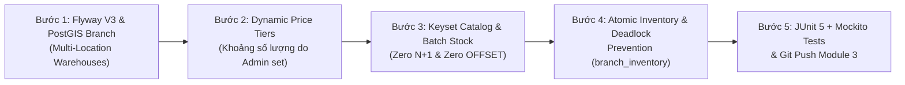
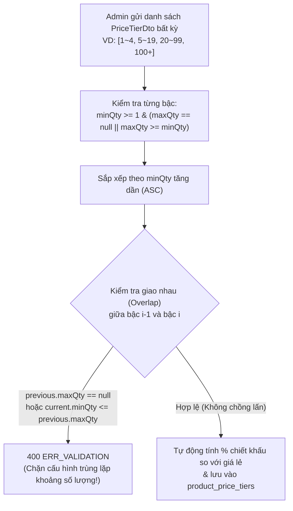

# Module 3 Implementation Guide — Multi-Branch Warehouse, Catalog, Dynamic Admin-Configured Wholesale Pricing & Atomic Inventory (For Inspection & Learning)

Tài liệu này ghi chép chi tiết từng bước triển khai **Module 3 (Multi-Branch Warehouse, Product Catalog, Dynamic Wholesale Price Tiers do Admin tự do thiết lập khoảng số lượng, và Quản lý Tồn kho Nguyên tử chống Race Condition & Deadlock)** để phục vụ việc kiểm tra (Code Review) và học tập chuyên sâu.

---

## Tổng quan Quy trình Triển khai Module 3



---

## Bước 1: Quản lý Đa Chi nhánh / Kho hàng tích hợp PostGIS (`com.b2b.warehouse.branch`)

### 1.1. Các file đã tạo
- [`BranchEntity.java`](file:///Users/xuantin/PersonalProjects/Master_Java/backend/src/main/java/com/b2b/warehouse/branch/entity/BranchEntity.java)
- [`BranchRepository.java`](file:///Users/xuantin/PersonalProjects/Master_Java/backend/src/main/java/com/b2b/warehouse/branch/repository/BranchRepository.java)
- [`BranchService.java`](file:///Users/xuantin/PersonalProjects/Master_Java/backend/src/main/java/com/b2b/warehouse/branch/service/BranchService.java) & [`AdminBranchController.java`](file:///Users/xuantin/PersonalProjects/Master_Java/backend/src/main/java/com/b2b/warehouse/branch/controller/AdminBranchController.java)

### 1.2. Điểm nhấn kỹ thuật (Dành cho việc học)
- Khi Admin thêm hoặc cập nhật một chi nhánh kho hàng qua `POST /api/v1/admin/branches`, [`BranchService.createPoint(longitude, latitude)`](file:///Users/xuantin/PersonalProjects/Master_Java/backend/src/main/java/com/b2b/warehouse/branch/service/BranchService.java#L100-L104) tự động sử dụng **JTS Topology Suite (`org.locationtech.jts.geom.GeometryFactory`)** để khởi tạo đối tượng `Point` hệ tọa độ chuẩn **WGS84 (`SRID = 4326`)** và lưu thẳng vào cột `geom GEOGRAPHY(Point, 4326)` của PostGIS.
- Lưu ý quan trọng trong GIS: Hệ tọa độ chuẩn của PostGIS/JTS luôn nhận **`(X = Longitude/Kinh độ, Y = Latitude/Vĩ độ)`**. Hàm `createPoint(double longitude, double latitude)` đóng gói quy chuẩn này tại 1 nơi duy nhất để tránh lỗi đảo ngược kinh độ - vĩ độ.

---

## Bước 2: Thiết kế Bảng Giá Sỉ Động — Khoảng Số Lượng Do Admin Tự Do Thiết Lập (`com.b2b.warehouse.catalog`)

### 2.1. Các file đã tạo
- Flyway Migration: [`V3__dynamic_price_tier_labels.sql`](file:///Users/xuantin/PersonalProjects/Master_Java/backend/src/main/resources/db/migration/V3__dynamic_price_tier_labels.sql)
- Entities: [`CategoryEntity.java`](file:///Users/xuantin/PersonalProjects/Master_Java/backend/src/main/java/com/b2b/warehouse/catalog/entity/CategoryEntity.java), [`ProductEntity.java`](file:///Users/xuantin/PersonalProjects/Master_Java/backend/src/main/java/com/b2b/warehouse/catalog/entity/ProductEntity.java), [`ProductPriceTierEntity.java`](file:///Users/xuantin/PersonalProjects/Master_Java/backend/src/main/java/com/b2b/warehouse/catalog/entity/ProductPriceTierEntity.java)
- Dynamic Pricing Engine: [`DynamicPriceTierValidator.java`](file:///Users/xuantin/PersonalProjects/Master_Java/backend/src/main/java/com/b2b/warehouse/catalog/service/DynamicPriceTierValidator.java)

### 2.2. Giải quyết bài toán "Khoảng số lượng trong bảng giá do Admin set, không áp cứng"
Thay vì thiết kế cứng 3 cột `tier1_price`, `tier2_price`, `tier3_price` trong bảng `products` hay ép cứng khoảng `1~3`, `4~6`, `7+` như dự án WordPress mẫu, chúng ta tách bảng **`product_price_tiers` (`1-N`)** kết hợp bộ kiểm duyệt toán học [`DynamicPriceTierValidator`](file:///Users/xuantin/PersonalProjects/Master_Java/backend/src/main/java/com/b2b/warehouse/catalog/service/DynamicPriceTierValidator.java):



1. **Linh hoạt tuyệt đối cho Admin**:
   - Sản phẩm A có thể cấu hình **2 bậc**: `1~10 thùng` và `11+ thùng`.
   - Sản phẩm B có thể cấu hình **4 bậc**: `1~4 thùng`, `5~19 thùng`, `20~99 thùng`, và `100+ thùng`.
   - Admin có thể gọi API riêng [`PUT /api/v1/admin/catalog/products/{productId}/price-tiers`](file:///Users/xuantin/PersonalProjects/Master_Java/backend/src/main/java/com/b2b/warehouse/catalog/controller/AdminCatalogController.java#L63-L73) để thay đổi cấu trúc bậc số lượng bất kỳ lúc nào.
2. **Thuật toán tra cứu giá động (`calculateQuote`)**:
   - Khi đối tác B2B nhập số lượng $Q$ trên bảng **Quick Order Matrix**, hàm [`DynamicPriceTierValidator.calculateQuote(product, Q)`](file:///Users/xuantin/PersonalProjects/Master_Java/backend/src/main/java/com/b2b/warehouse/catalog/service/DynamicPriceTierValidator.java#L96-L154) tự động tìm bậc thỏa mãn $\text{minQty} \le Q \le \text{maxQty}$ (hoặc $\text{maxQty} = \text{null}$).
   - **Xử lý an toàn khi Admin cấu hình ngắt quãng (Gap Fallback)**: Giả sử Admin cấu hình bậc 1 là `1~5` và bậc 2 là `10+` (bỏ trống khoảng `6~9`), nếu khách đặt $Q = 7$, thuật toán tự động áp dụng mức giá ưu đãi của bậc thấp hơn gần nhất thỏa mãn $\text{minQty} \le 7$ (tức bậc `1~5`), không bao giờ gây lỗi hệ thống.

---

## Bước 3: Phân trang Keyset (Seek Pagination) & Chống N+1 khi gộp Tồn kho Đa Chi nhánh

### 3.1. Các file đã tạo
- [`ProductRepository.java`](file:///Users/xuantin/PersonalProjects/Master_Java/backend/src/main/java/com/b2b/warehouse/catalog/repository/ProductRepository.java)
- [`CatalogService.java`](file:///Users/xuantin/PersonalProjects/Master_Java/backend/src/main/java/com/b2b/warehouse/catalog/service/CatalogService.java)
- [`PublicAndB2bCatalogController.java`](file:///Users/xuantin/PersonalProjects/Master_Java/backend/src/main/java/com/b2b/warehouse/catalog/controller/PublicAndB2bCatalogController.java)

### 3.2. Hai kỹ thuật tối ưu SQL quan trọng trong [`CatalogService.listB2bProductsKeyset`](file:///Users/xuantin/PersonalProjects/Master_Java/backend/src/main/java/com/b2b/warehouse/catalog/service/CatalogService.java#L228-L273)
1. **Keyset Pagination với kỹ thuật `limit + 1`**:
   - Thay vì chạy câu lệnh `SELECT COUNT(*)` đắt đỏ để biết còn trang tiếp theo hay không, chúng ta truyền `PageRequest.of(0, safeLimit + 1)`.
   - Nếu khách yêu cầu `limit = 20`, hệ thống lấy tối đa `21` dòng theo con trỏ `(createdAt < :cursorCreatedAt)`. Nếu trả về đủ `21` dòng $\rightarrow$ chắc chắn `hasNext = true`, cắt lấy `20` dòng đầu và trả về con trỏ của phần tử thứ 20!
2. **Batch Aggregation Tồn kho (`sumAvailableStockByProductIds`) — Zero N+1**:
   - Để hiển thị tổng tồn kho khả dụng (`totalAvailableStock`) cho 20 sản phẩm trên trang Catalog B2B, nếu gọi `sumStock(productId)` trong vòng lặp `for` sẽ sinh ra **20 câu SQL phụ (N+1)**.
   - Thay vào đó, chúng ta gom toàn bộ 20 `productIds` và gọi **1 câu SQL `GROUP BY` duy nhất** tại [`BranchInventoryRepository.sumAvailableStockByProductIds`](file:///Users/xuantin/PersonalProjects/Master_Java/backend/src/main/java/com/b2b/warehouse/inventory/repository/BranchInventoryRepository.java#L54-L62):
     ```sql
     SELECT bi.product.id AS productId, COALESCE(SUM(bi.availableQty), 0) AS totalAvailable
     FROM BranchInventoryEntity bi
     JOIN bi.branch b
     WHERE b.isActive = TRUE AND bi.product.id IN :productIds
     GROUP BY bi.product.id
     ```
   - Sau đó ghép vào `Map<UUID, Integer> stockMap` trên RAM với độ phức tạp $O(1)$.

---

## Bước 4: Quản lý Tồn kho Nguyên tử (Atomic Stock Reservation) & Chống Deadlock PostgreSQL

### 4.1. Các file đã tạo
- [`BranchInventoryEntity.java`](file:///Users/xuantin/PersonalProjects/Master_Java/backend/src/main/java/com/b2b/warehouse/inventory/entity/BranchInventoryEntity.java)
- [`BranchInventoryRepository.java`](file:///Users/xuantin/PersonalProjects/Master_Java/backend/src/main/java/com/b2b/warehouse/inventory/repository/BranchInventoryRepository.java)
- [`InventoryService.java`](file:///Users/xuantin/PersonalProjects/Master_Java/backend/src/main/java/com/b2b/warehouse/inventory/service/InventoryService.java) & [`AdminInventoryController.java`](file:///Users/xuantin/PersonalProjects/Master_Java/backend/src/main/java/com/b2b/warehouse/inventory/controller/AdminInventoryController.java)

### 4.2. Giải quyết 2 bài toán kinh điển nhất của hệ thống E-Commerce High-Traffic
1. **Chống Overselling (Bán vượt tồn kho khi 100 đối tác B2B cùng đặt hàng 1 lúc):**
   - **Cách làm sai (Anti-pattern)**: Đọc `entity.getAvailableQty()` lên Java $\rightarrow$ kiểm tra `if (available >= qty)` $\rightarrow$ `entity.setAvailableQty(available - qty)` $\rightarrow$ `save()`. Khi 2 request chạy song song, cả hai cùng đọc thấy tồn kho = 10 và cùng trừ đi 8 $\rightarrow$ âm kho!
   - **Cách làm chuẩn Senior ([`BranchInventoryRepository.reserveStockAtomically`](file:///Users/xuantin/PersonalProjects/Master_Java/backend/src/main/java/com/b2b/warehouse/inventory/repository/BranchInventoryRepository.java#L71-L86))**:
     ```sql
     UPDATE branch_inventory
     SET available_qty = available_qty - :qty,
         reserved_qty  = reserved_qty + :qty,
         version       = version + 1,
         updated_at    = CURRENT_TIMESTAMP
     WHERE branch_id = :branchId
       AND product_id = :productId
       AND available_qty >= :qty
     ```
   - PostgreSQL thực thi kiểm tra điều kiện `available_qty >= :qty` và trừ kho ngay trong **1 lệnh Atomic Row-Level Lock**. Nếu số dòng cập nhật trả về `updatedRows == 0`, [`InventoryService`](file:///Users/xuantin/PersonalProjects/Master_Java/backend/src/main/java/com/b2b/warehouse/inventory/service/InventoryService.java#L102-L108) lập tức ném `409 Conflict (ERR_INSUFFICIENT_INVENTORY)` và rollback toàn bộ đơn hàng.
2. **Chống Database Deadlock khi đặt đơn hàng nhiều sản phẩm ([`InventoryService.reserveStockForOrder`](file:///Users/xuantin/PersonalProjects/Master_Java/backend/src/main/java/com/b2b/warehouse/inventory/service/InventoryService.java#L92-L95)):**
   - Giả sử Đơn hàng 1 gồm `[Sản phẩm B, Sản phẩm A]` và Đơn hàng 2 gồm `[Sản phẩm A, Sản phẩm B]`. Nếu khóa dòng theo thứ tự giỏ hàng của khách, Transaction 1 giữ khóa B chờ A, còn Transaction 2 giữ khóa A chờ B $\rightarrow$ **PostgreSQL Deadlock!**
   - Giải pháp: Trước khi vòng lặp `for` gọi `reserveStockAtomically`, chúng ta luôn **sắp xếp danh sách sản phẩm theo `productId ASC`**:
     ```java
     List<StockReservationItemDto> sortedItems = items.stream()
             .sorted(Comparator.comparing(StockReservationItemDto::productId))
             .toList();
     ```
   - Mọi transaction luôn xin khóa theo thứ tự `A -> B`, **triệt tiêu 100% nguy cơ Deadlock**.

---

## Bước 5: Kiểm thử JUnit 5 + Mockito cho Module 3

1. [`DynamicPriceTierValidatorTest.java`](file:///Users/xuantin/PersonalProjects/Master_Java/backend/src/test/java/com/b2b/warehouse/catalog/service/DynamicPriceTierValidatorTest.java):
   - Kiểm tra Admin tự cấu hình 4 bậc số lượng tùy ý (`1~4`, `5~19`, `20~99`, `100+`).
   - Kiểm tra tính toán báo giá động (`calculateQuote`) cho các mức số lượng khác nhau.
   - Kiểm tra chặn cấu hình khoảng số lượng chồng lấn (`1~6` và `5~12`) và chặn bậc mở (`maxQty = null`) nằm trước bậc khác.
2. [`CatalogServiceTest.java`](file:///Users/xuantin/PersonalProjects/Master_Java/backend/src/test/java/com/b2b/warehouse/catalog/service/CatalogServiceTest.java):
   - Kiểm tra tạo sản phẩm kèm bậc giá động và thay đổi toàn bộ cấu trúc bậc giá (`replaceProductPriceTiers` từ 2 bậc sang 4 bậc mới).
   - Kiểm tra phân trang Keyset kết hợp gộp tồn kho hàng loạt (`sumAvailableStockByProductIds`).
3. [`InventoryServiceTest.java`](file:///Users/xuantin/PersonalProjects/Master_Java/backend/src/test/java/com/b2b/warehouse/inventory/service/InventoryServiceTest.java):
   - Dùng `Mockito.inOrder` chứng minh danh sách mặt hàng bị truyền ngược thứ tự UUID vẫn được khóa theo đúng thứ tự tăng dần `smallerProductId -> largerProductId` để chống Deadlock.
   - Kiểm tra ném lỗi `ERR_INSUFFICIENT_INVENTORY` khi `reserveStockAtomically` trả về `0`.
