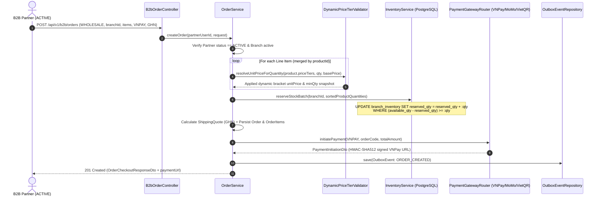

# Module 4 Implementation Guide — B2B Wholesale & Free Sample Order Engine, Vietnam Payment/Shipping Gateways & Analytics

> **Target Audience**: Mid-to-Senior Java Backend Engineers & System Architects  
> **Module Scope**: B2B Wholesale Order Engine (with Admin Dynamic Price Tiers), Free Sample Request Workflow (`SAMPLE_REQUEST`), Pluggable Vietnam Payment Gateways (`VNPay`, `MoMo`, `VietQR` replacing Toss/NaverPay), Vietnam Shipping Gateways (`GHN`, `GHTK`, `AhaMove`, `SELF_PICKUP`), Transactional Outbox Pattern, and Partner/Admin Sales Analytics.

---

## 1. Architectural Overview & Core Engineering Challenges

When migrating from the legacy Korean WordPress B2B project (`/Users/xuantin/Local Sites/umego/app`) to a high-concurrency enterprise Java system tailored for the Vietnam market, Module 4 solves **five critical production challenges**:

1. **Dynamic Wholesale Tier Pricing & Snapshot Integrity**:
   - In the legacy WordPress app (`order-form.php`), wholesale pricing tiers were hardcoded (`1~3`, `4~6`, `7+`) and calculated in PHP templates.
   - In our architecture, the Admin defines **100% custom quantity brackets** (`minQty` ~ `maxQty`) per product. During checkout, `OrderService` invokes `DynamicPriceTierValidator.resolveUnitPriceForQuantity(...)` to resolve the exact bracket and **snapshots** both `appliedUnitPrice` and `appliedTierMinQty` onto `order_items`. Even if the Admin changes the product's price tiers tomorrow, historical orders and financial reports remain 100% immutable.

2. **Dual Order Modes (`WHOLESALE` vs. `SAMPLE_REQUEST`)**:
   - **Wholesale Orders (`WHOLESALE`)**: Enforce minimum order quantity (`MOQ`), calculate dynamic tiered unit prices, calculate shipping fees via Vietnam 3PL carriers, and initiate payment (`VNPay`, `MoMo`, `VietQR`, `BANK_TRANSFER`).
   - **Free Sample Requests (`SAMPLE_REQUEST`)**: Enforce two business guardrails:
     - `product.sampleAllowed == true`
     - `requestedQuantity <= product.maxSampleQty` (per-product sample cap set by Admin)
     - Merchandise subtotal is `0 VND` (`FREE_SAMPLE`), while the partner only covers the shipping fee (or `0 VND` if `SELF_PICKUP`).

3. **Zero Overselling & Deadlock-Free Atomic Stock Lifecycle**:
   - **Checkout (`createOrder`)**: Reserves stock atomically in PostgreSQL (`reserved_qty = reserved_qty + :qty WHERE (available_qty - reserved_qty) >= :qty`) sorted by `productId ASC` to eliminate deadlocks.
   - **Cancellation / Payment Expiry**: Releases reserved stock atomically (`reserved_qty = reserved_qty - :qty`).
   - **Delivery / Fulfillment (`DELIVERED` / `COMPLETED`)**: Permanently deducts physical inventory and reservation simultaneously (`available_qty = available_qty - :qty, reserved_qty = reserved_qty - :qty`).

4. **Pluggable Vietnam Payment & Shipping Gateways (Strategy + Router Pattern)**:
   - Replaced Korean `Toss Payments` / `KG Inicis` with **`VNPay` (HMAC-SHA512)**, **`MoMo` (HMAC-SHA256)**, and **`VietQR` (NAPAS 247 Dynamic EMVCo QR)**.
   - Replaced Korean `CJ Logistics` / `Lotte` with **`Giao Hàng Nhanh (GHN)`**, **`Giao Hàng Tiết Kiệm (GHTK)`**, **`AhaMove`** (Haversine GPS distance-based instant delivery), and **`SELF_PICKUP`**.
   - **Idempotent IPN Webhook Verification**: Uses constant-time signature verification (`MessageDigest.isEqual`) to prevent timing side-channel attacks and checks `PaymentTransactionEntity.status == SUCCESS` before processing to prevent double-crediting when VNPay/MoMo retries webhooks.

5. **Transactional Outbox Pattern (`outbox_events`)**:
   - Instead of publishing directly to Kafka inside `@Transactional createOrder(...)` (which suffers from the **Dual-Write Problem** if Kafka is temporarily unreachable or the DB transaction rolls back), all domain events (`ORDER_CREATED`, `ORDER_PAYMENT_CONFIRMED`, `ORDER_STATUS_CHANGED`) are persisted into the `outbox_events` table in the **exact same ACID database transaction** as the order state change.

---

## 2. Step-by-Step Implementation Workflow

### Step 1: Transactional Outbox Persistence (`com.b2b.warehouse.outbox`)
- Created [`OutboxEventEntity.java`](file:///Users/xuantin/PersonalProjects/Master_Java/backend/src/main/java/com/b2b/warehouse/outbox/entity/OutboxEventEntity.java) mapped to `outbox_events` (`JSONB payload`, `aggregate_type`, `aggregate_id`, `event_type`, `published`).
- Created [`OutboxEventRepository.java`](file:///Users/xuantin/PersonalProjects/Master_Java/backend/src/main/java/com/b2b/warehouse/outbox/repository/OutboxEventRepository.java) with `findTop100ByPublishedFalseOrderByCreatedAtAsc()` for the Kafka relay poller.

### Step 2: Order, Line Item & Payment Transaction Domain (`com.b2b.warehouse.order`)
- **Enums**:
  - [`OrderType.java`](file:///Users/xuantin/PersonalProjects/Master_Java/backend/src/main/java/com/b2b/warehouse/order/entity/OrderType.java): `WHOLESALE`, `SAMPLE_REQUEST`.
  - [`OrderStatus.java`](file:///Users/xuantin/PersonalProjects/Master_Java/backend/src/main/java/com/b2b/warehouse/order/entity/OrderStatus.java): `PENDING_PAYMENT`, `PENDING_APPROVAL`, `APPROVED`, `PACKING`, `SHIPPED`, `DELIVERED`, `COMPLETED`, `CANCELLED`, `REFUNDED`.
  - [`PaymentMethod.java`](file:///Users/xuantin/PersonalProjects/Master_Java/backend/src/main/java/com/b2b/warehouse/order/entity/PaymentMethod.java): `VNPAY`, `MOMO`, `VIETQR`, `BANK_TRANSFER`, `COD`, `FREE_SAMPLE`.
  - [`ShippingProvider.java`](file:///Users/xuantin/PersonalProjects/Master_Java/backend/src/main/java/com/b2b/warehouse/order/entity/ShippingProvider.java): `GHN`, `GHTK`, `AHAMOVE`, `SELF_PICKUP`.
- **Entities**:
  - [`OrderEntity.java`](file:///Users/xuantin/PersonalProjects/Master_Java/backend/src/main/java/com/b2b/warehouse/order/entity/OrderEntity.java) & [`OrderItemEntity.java`](file:///Users/xuantin/PersonalProjects/Master_Java/backend/src/main/java/com/b2b/warehouse/order/entity/OrderItemEntity.java): Snapshot `productSku`, `productName`, `appliedUnitPrice`, `appliedTierMinQty`, and `lineTotal`.
  - [`PaymentTransactionEntity.java`](file:///Users/xuantin/PersonalProjects/Master_Java/backend/src/main/java/com/b2b/warehouse/order/entity/PaymentTransactionEntity.java): Tracks `provider`, `transactionRef`, `providerTransId`, `amount`, `status`, and `rawWebhookJson` (`JSONB`).
- **Repository SQL Optimization (`OrderRepository.java`)**:
  - Uses `@EntityGraph(attributePaths = {"partner", "branch", "items", "items.product"})` on `findWithDetailsById` and `findWithDetailsByOrderCode` so an entire order + all line items + branch + partner load in **1 SQL `LEFT JOIN` query (Zero N+1)**.
  - Uses single-pass JPQL aggregation queries (`sumCompletedSpendByPartner`, `sumCompletedRevenueInPeriod`, `sumOrderCountsByTypeInPeriod`) for the Partner and Admin dashboards instead of loading entities into JVM memory.

### Step 3: Vietnam Payment & Shipping Strategy Routers (`com.b2b.warehouse.gateway`)
- **Cryptographic Signature Utility ([`HmacSignUtil.java`](file:///Users/xuantin/PersonalProjects/Master_Java/backend/src/main/java/com/b2b/warehouse/gateway/payment/HmacSignUtil.java))**:
  - Implements `hmacSha512Hex` (for VNPay `vnp_SecureHash`), `hmacSha256Hex` (for MoMo `signature`), and `constantTimeHexEquals` (`MessageDigest.isEqual`) to prevent timing attacks on payment webhooks.
- **Payment Gateways**:
  - [`VnPayPaymentGateway.java`](file:///Users/xuantin/PersonalProjects/Master_Java/backend/src/main/java/com/b2b/warehouse/gateway/payment/VnPayPaymentGateway.java): Builds canonical sorted query strings (`vnp_Version=2.1.0`, `vnp_Amount=amount*100`, `vnp_TxnRef`, etc.) and signs/verifies with `HMAC-SHA512`.
  - [`MomoPaymentGateway.java`](file:///Users/xuantin/PersonalProjects/Master_Java/backend/src/main/java/com/b2b/warehouse/gateway/payment/MomoPaymentGateway.java): Builds canonical key-value chains (`accessKey=...&amount=...&orderId=...`) and signs/verifies with `HMAC-SHA256`.
  - [`VietQrPaymentGateway.java`](file:///Users/xuantin/PersonalProjects/Master_Java/backend/src/main/java/com/b2b/warehouse/gateway/payment/VietQrPaymentGateway.java): Generates dynamic NAPAS 247 VietQR image URLs with pre-filled amount and `addInfo=<orderCode>`.
- **Shipping Gateways**:
  - [`GhnShippingGateway.java`](file:///Users/xuantin/PersonalProjects/Master_Java/backend/src/main/java/com/b2b/warehouse/gateway/shipping/GhnShippingGateway.java), [`GhtkShippingGateway.java`](file:///Users/xuantin/PersonalProjects/Master_Java/backend/src/main/java/com/b2b/warehouse/gateway/shipping/GhtkShippingGateway.java), [`AhamoveShippingGateway.java`](file:///Users/xuantin/PersonalProjects/Master_Java/backend/src/main/java/com/b2b/warehouse/gateway/shipping/AhamoveShippingGateway.java) (computes real Haversine distance in km between warehouse branch GPS and partner delivery GPS), and [`SelfPickupShippingGateway.java`](file:///Users/xuantin/PersonalProjects/Master_Java/backend/src/main/java/com/b2b/warehouse/gateway/shipping/SelfPickupShippingGateway.java).

### Step 4: Order Engine & Analytics Controllers
- **B2B Partner Endpoints ([`B2bOrderController.java`](file:///Users/xuantin/PersonalProjects/Master_Java/backend/src/main/java/com/b2b/warehouse/order/controller/B2bOrderController.java))**:
  - `POST /api/v1/b2b/orders`: Place a wholesale order or free sample request.
  - `GET /api/v1/b2b/orders`: Cursor-paginated (`O(1)` keyset pagination) partner order history.
  - `GET /api/v1/b2b/orders/{orderId}`: Detailed order view with ownership check (`ERR_ACCESS_DENIED` if another partner attempts to view).
  - `GET /api/v1/b2b/orders/dashboard-overview`: Partner dashboard KPIs (completed wholesale spend, sample request count, pending orders, credit limit & balance).
- **Admin Endpoints ([`AdminOrderController.java`](file:///Users/xuantin/PersonalProjects/Master_Java/backend/src/main/java/com/b2b/warehouse/order/controller/AdminOrderController.java))**:
  - `GET /api/v1/admin/orders`: Filter orders by `status` and `orderType` with keyset pagination.
  - `PATCH /api/v1/admin/orders/{orderId}/status`: State machine transition + atomic stock release (`CANCELLED`) or permanent deduction (`DELIVERED`/`COMPLETED`).
  - `POST /api/v1/admin/orders/waybills/bulk`: Bulk waybill & tracking code assignment (`PACKING` -> `SHIPPED`) replacing the legacy `order-detail.php` Excel form.
  - `GET /api/v1/admin/orders/analytics/kpis`: Executive KPI aggregation (`totalCompletedRevenue`, `wholesaleOrdersCount`, `sampleRequestsCount`, `pendingApprovalOrdersCount`, `pendingPaymentOrdersCount`).
- **Public Payment Webhook Receiver ([`PaymentWebhookController.java`](file:///Users/xuantin/PersonalProjects/Master_Java/backend/src/main/java/com/b2b/warehouse/order/controller/PaymentWebhookController.java))**:
  - `POST /api/v1/webhooks/payment/{provider}`: Verifies cryptographic signatures (`VNPay` / `MoMo` / `VietQR`) and transitions `PENDING_PAYMENT` -> `PENDING_APPROVAL` idempotently.

---

## 3. Sequence Diagram: Wholesale Checkout & Idempotent Webhook Flow

---

## 4. Verification & Unit Testing Suite (JUnit 5 + Mockito)

Two comprehensive test suites were added in Module 4:
1. [`GatewayRouterAndSignatureTest.java`](file:///Users/xuantin/PersonalProjects/Master_Java/backend/src/test/java/com/b2b/warehouse/gateway/GatewayRouterAndSignatureTest.java):
   - Verifies `VNPay` HMAC-SHA512 signature generation, valid webhook verification, and tampered amount rejection.
   - Verifies `MoMo` HMAC-SHA256 signature verification.
   - Verifies `AhaMove` Haversine GPS distance fee calculation and `SELF_PICKUP` zero-fee quote.
2. [`OrderServiceTest.java`](file:///Users/xuantin/PersonalProjects/Master_Java/backend/src/test/java/com/b2b/warehouse/order/service/OrderServiceTest.java):
   - Verifies wholesale order dynamic price tier resolution (`35 boxes -> 135,000 VND`), atomic stock reservation, VNPay initiation, and Outbox event persistence.
   - Verifies free sample request (`SAMPLE_REQUEST`) zero-cost merchandise calculation and `maxSampleQty` enforcement (`ERR_SAMPLE_LIMIT_EXCEEDED`).
   - Verifies idempotent payment webhook processing (second duplicate webhook is safely ignored) and tampered signature rejection (`ERR_INVALID_WEBHOOK_SIGNATURE`).
   - Verifies atomic stock release on `CANCELLED` and permanent stock deduction on `DELIVERED`.
