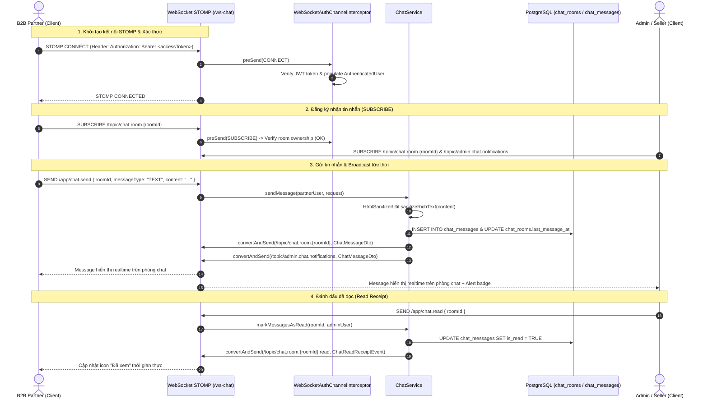

# Module 6 Implementation Guide — Real-time Support Chatbox (WebSocket STOMP over SockJS)

> **Target Audience**: Mid-to-Senior Java Backend Engineers & System Architects  
> **Module Scope**: Real-time B2B Partner ↔ Admin/Seller Support Chatbox, Spring WebSocket STOMP Message Broker, JWT Dual-Token Handshake Interceptor, Room Isolation & Security, Keyset-paginated Chat History, Read Receipts, and Notification Fan-out.

---

## 1. Architectural Overview & Core Engineering Challenges

In Module 6, we implement the real-time communication backbone between verified B2B Partners and internal Admin/Manager/Seller support personnel:

1. **Giao thức Kết nối Real-Time (WebSocket + STOMP over SockJS)**:
   - Dùng giao thức **STOMP (Simple Text Oriented Messaging Protocol)** chạy trên nền WebSocket với fallback SockJS cho các môi trường proxy/firewall chặn raw WebSocket.
   - Endpoint kết nối: `/ws-chat` (hỗ trợ cả SockJS và Native WebSocket).
   - Application destination: `/app` (định tuyến đến các `@MessageMapping` controller).
   - Broker destinations: `/topic` (pub/sub broadcast cho room chat và admin alerts), `/queue` & `/user` (tin nhắn riêng).

2. **Bảo mật Kết nối & Phân Quyền STOMP (ChannelInterceptor + JWT Token)**:
   - WebSocket bắt đầu bằng HTTP upgrade request nhưng giao dịch tiếp theo diễn ra qua các STOMP frames (`CONNECT`, `SUBSCRIBE`, `SEND`).
   - [`WebSocketAuthChannelInterceptor`](file:///Users/xuantin/PersonalProjects/Master_Java/backend/src/main/java/com/b2b/warehouse/chat/config/WebSocketAuthChannelInterceptor.java) chặn frame `CONNECT`, bóc tách header `Authorization: Bearer <accessToken>`, xác thực chữ ký HMAC-SHA256 qua [`JwtTokenProvider`](file:///Users/xuantin/PersonalProjects/Master_Java/backend/src/main/java/com/b2b/warehouse/auth/security/JwtTokenProvider.java) và gắn `AuthenticatedUser` vào Security Context của session WebSocket.
   - Khi client gửi frame `SUBSCRIBE` đến `/topic/chat.room.{roomId}`:
     - **B2B Partner**: Chỉ được subscribe vào phòng chat của chính mình (`partner_user_id == currentUserId`). Nếu cố tình subscribe vào phòng của đối tác khác, interceptor ném `ERR_FORBIDDEN` lập tức ngắt lệnh.
     - **Admin / Manager / Seller**: Có quyền subscribe vào mọi phòng chat của khách hàng để hỗ trợ trực tiếp.
     - Kênh thông báo tổng `/topic/admin.chat.notifications`: Chỉ có nhân sự nội bộ (`ADMIN`, `MANAGER`, `SELLER`) mới được phép subscribe.

3. **Phòng Chat Riêng Biệt & Vòng Đời Tự Động (`chat_rooms`)**:
   - Mỗi B2B Partner sở hữu duy nhất 1 phòng chat hỗ trợ chuyên biệt (`partner_user_id UNIQUE`).
   - Khi đối tác mở chatbox, API `getOrCreateRoomForPartner` tự động kích hoạt hoặc trả về phòng hiện tại.
   - Khi phòng đang ở trạng thái `CLOSED` mà đối tác gửi tin nhắn mới, hệ thống tự động mở lại phòng (`OPEN`) để nhân viên hỗ trợ kịp thời tiếp nhận.
   - Hỗ trợ gán nhân viên phụ trách (`assigned_admin_id`) và đóng/mở phòng (`status = OPEN/CLOSED`).

4. **Đa dạng Loại Tin Nhắn & Chống Tấn Công XSS (`chat_messages`)**:
   - `TEXT`: Tin nhắn văn bản thông thường, được thanh lọc qua OWASP [`HtmlSanitizerUtil`](file:///Users/xuantin/PersonalProjects/Master_Java/backend/src/main/java/com/b2b/warehouse/common/util/HtmlSanitizerUtil.java) trước khi lưu DB và broadcast, triệt tiêu mọi nguy cơ Stored XSS khi nhân viên đọc chat.
   - `IMAGE`: Đường dẫn ảnh đính kèm (hóa đơn, giấy phép, ảnh sản phẩm lỗi...).
   - `ORDER_REF`: Mã đơn hàng tham chiếu (`#UM-261013-XXXX`) giúp đối tác và nhân viên trao đổi trực tiếp về một đơn sỉ hoặc đơn mẫu cụ thể.

5. **Phân Trang Keyset & Đánh Dấu Đã Đọc Siêu Tốc (Read Receipts)**:
   - Truy vấn lịch sử tin nhắn dùng **Keyset Seek** `WHERE room_id = :roomId AND id < :cursorMessageId ORDER BY id DESC LIMIT :limit` dựa trên composite index `idx_chat_messages_room_id_desc (room_id, id DESC)`.
   - Đánh dấu đã đọc thực hiện qua 1 câu lệnh SQL UPDATE nguyên tử duy nhất:
     ```sql
     UPDATE chat_messages
     SET is_read = TRUE
     WHERE room_id = :roomId AND sender_id != :readerId AND is_read = FALSE;
     ```
   - Ngay khi có tin nhắn được đọc, hệ thống broadcast sự kiện `ChatReadReceiptEvent` đến `/topic/chat.room.{roomId}.read` để hai bên cập nhật trạng thái "Đã xem" tức thì trên giao diện.

---

## 2. Sơ Đồ Luồng Kết Nối STOMP & Nhắn Tin Real-Time



---

## 3. Danh Sách Endpoint REST & STOMP

### REST Endpoints
| Phương thức | Endpoint | Phân quyền | Mô tả |
| :--- | :--- | :--- | :--- |
| `GET` | `/api/v1/b2b/chat/room` | `B2B_PARTNER` | Lấy hoặc tự động tạo phòng chat của Partner |
| `GET` | `/api/v1/b2b/chat/rooms/{roomId}/messages` | Authenticated | Lấy lịch sử tin nhắn phòng chat (Keyset Seek) |
| `POST` | `/api/v1/b2b/chat/rooms/{roomId}/read` | Authenticated | Đánh dấu các tin nhắn trong phòng là đã đọc |
| `POST` | `/api/v1/b2b/chat/messages` | Authenticated | Gửi tin nhắn qua REST (dùng khi WebSocket reconnect) |
| `GET` | `/api/v1/admin/chat/rooms` | `ADMIN`, `MANAGER`, `SELLER` | Danh sách phòng chat kèm số tin chưa đọc và bộ lọc trạng thái |
| `GET` | `/api/v1/admin/chat/rooms/{roomId}` | `ADMIN`, `MANAGER`, `SELLER` | Chi tiết phòng chat cụ thể |
| `PATCH` | `/api/v1/admin/chat/rooms/{roomId}/assign` | `ADMIN`, `MANAGER` | Phân công nhân viên phụ trách phòng |
| `PATCH` | `/api/v1/admin/chat/rooms/{roomId}/status` | `ADMIN`, `MANAGER` | Chuyển đổi trạng thái phòng (`OPEN`/`CLOSED`) |

### STOMP Endpoints
| Hướng | Destination | Payload | Mô tả |
| :--- | :--- | :--- | :--- |
| Client $\rightarrow$ Server | `/app/chat.send` | `SendMessageRequestDto` | Gửi tin nhắn real-time |
| Client $\rightarrow$ Server | `/app/chat.read` | `{ "roomId": "UUID" }` | Đánh dấu đã đọc real-time |
| Server $\rightarrow$ Client | `/topic/chat.room.{roomId}` | `ChatMessageDto` | Broadcast tin nhắn mới cho mọi người trong phòng |
| Server $\rightarrow$ Client | `/topic/chat.room.{roomId}.read` | `ChatReadReceiptEvent` | Broadcast sự kiện đã đọc cho phòng chat |
| Server $\rightarrow$ Client | `/topic/admin.chat.notifications` | `ChatMessageDto` | Broadcast thông báo tin nhắn mới cho Admin/Seller |

---

## 4. Kết Quả Kiểm Thử (JUnit 5 + Mockito — 56/56 Tests Passed)

Module 6 bổ sung 9 bài test tự động chuyên sâu:
1. [`ChatServiceTest.java`](file:///Users/xuantin/PersonalProjects/Master_Java/backend/src/test/java/com/b2b/warehouse/chat/service/ChatServiceTest.java):
   - Tạo phòng tự động khi chưa tồn tại và nạp profile doanh nghiệp.
   - Gửi tin nhắn, khử độc mã độc XSS `<script>`, cập nhật `last_message_at` và broadcast đồng thời ra 2 topic STOMP.
   - Ngăn chặn đối tác B2B xâm nhập phòng chat của đối tác khác (`ERR_FORBIDDEN`).
   - Đánh dấu đã đọc nguyên tử và phát sinh sự kiện `ChatReadReceiptEvent`.
   - Phân công nhân viên quản trị và đóng/mở trạng thái phòng.
2. [`WebSocketAuthChannelInterceptorTest.java`](file:///Users/xuantin/PersonalProjects/Master_Java/backend/src/test/java/com/b2b/warehouse/chat/config/WebSocketAuthChannelInterceptorTest.java):
   - Kiểm tra xác thực token JWT Bearer trên frame STOMP `CONNECT`.
   - Từ chối kết nối khi thiếu token (`ERR_UNAUTHORIZED`).
   - Cho phép nhân viên quản trị subscribe vào topic thông báo chung `/topic/admin.*` và chặn đứng đối tác ngoài.
   - Cách ly tuyệt đối phòng chat giữa các đối tác trên frame `SUBSCRIBE`.
